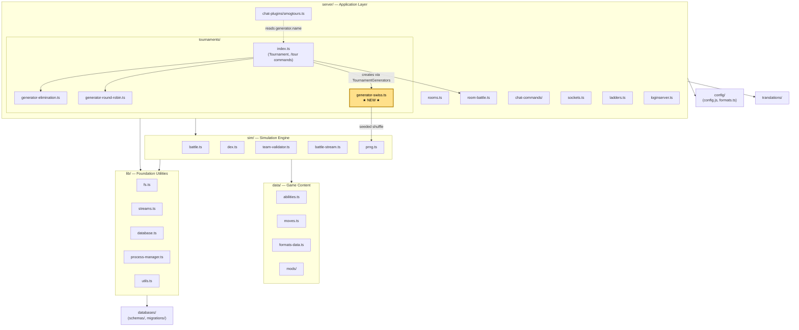

# Design Note: Swiss-System Room Tournaments

| | |
|---|---|
| **Status** | Implemented. Written before any feature code, then revised after building (§12) |
| **Date** | 2026-11-21 |
| **Issue** | [smogon/pokemon-showdown#2205](https://github.com/smogon/pokemon-showdown/issues/2205): "Implement Best of 3 and/or Swiss Rounds for Room Tours" |
| **Base** | `upstream/master` at `f1040ecb5` |
| **Branch** | `swiss-tournaments` |
| **Area** | `server/tournaments/` |

This note will become an Architecture Decision Record. It is written for someone reading it a year from now who wants to know why Swiss tournaments work the way they do, and what was rejected.

---

## 1. What the feature does

Room tournaments currently come in two shapes: **Elimination** (`server/tournaments/generator-elimination.ts`) and **Round Robin** (`server/tournaments/generator-round-robin.ts`). This change adds a third: **Swiss**.

In a Swiss tournament, nobody is eliminated. Everyone plays a fixed number of rounds. In each round, players are paired against opponents with the same or a similar record, and nobody plays the same opponent twice. The final standings are ordered by points, with a tie-breaker. Swiss handles far more players than Round Robin (which needs *n − 1* rounds), and it gives every player more games than Elimination (where half the field plays once).

A room staff member would use it like this:

```
/tour create gen9vgc2025regi, swiss          (number of rounds chosen automatically)
/tour create gen9vgc2025regi, swiss, 32, 5   (player cap 32, exactly 5 rounds)
/tour settype swiss, 32, 5                   (switch an existing tour before it starts)
/tour rules Best Of = 3                      (existing feature: makes every match a Bo3)
```

### Who asked for it

Issue #2205 asked for Best-of-3 and for Swiss rounds, so VGC players could practise in the format used at Play! Pokémon Premier Challenges and Regionals. Best-of-3 was implemented since then (`server/room-battle-bestof.ts`, and the `Best Of` rule in `data/rulesets.ts`), and it already works in tours (`Tournament.onBattleWin` reads `BestOfGame.score`). Swiss is the half of the issue that is still open. The issue has no maintainer comments, so there is no maintainer-written specification. The acceptance criteria below are mine.

### Acceptance criteria

Every criterion is checked by at least one automated test (see §10).

| # | Criterion |
|---|---|
| AC1 | `/tour create <format>, swiss` creates a tournament whose generator is reported as `Swiss`. `/tour settype swiss` also works. An unknown type's error message lists `swiss` among the valid types. |
| AC2 | The optional 4th argument (`<rounds>`, already in the `/tour create` usage text) sets the number of rounds. It must be a positive integer, otherwise the command is rejected with an error message. When it is given, the generator name records it (`5-Round Swiss`), the same way `Double Elimination` and `Double Round Robin` record their modifiers. When it is omitted, the number of rounds is ⌈log₂ *n*⌉ for *n* players at start (minimum 1). |
| AC3 | Round 1 pairs players randomly. From round 2 on, players are paired with the closest-ranked opponent they have **not** already played. If no rematch-free pairing exists, a rematch is allowed rather than stalling the tournament. |
| AC4 | Round *r + 1* is only paired after every match in round *r* has finished. |
| AC5 | With an odd number of active players, one player gets a **bye**, worth one point. The bye goes to the lowest-ranked player who has not had one yet. |
| AC6 | Draws are accepted and are worth half a point to each player. |
| AC7 | A disqualified player's unfinished current-round match is awarded to the opponent. The disqualified player is never paired again and is ranked below every player who was not disqualified. If fewer than two active players remain, the tournament ends. |
| AC8 | After the last round, the tournament ends and announces results as ranked groups, ordered by points and then Buchholz score (§4.4). Players who are still tied share a group. |
| AC9 | The bracket view works in the **existing** client without changes: during sign-ups it is a player list, and after the start it is a crosstable with scores and live links to battles in progress. |
| AC10 | Elimination and Round Robin behave exactly as before. The full existing test suite passes. |
| AC11 | `/tour help`, `/tournamenthelp`, the `/tour` tournament list, and `PROTOCOL.md` mention Swiss. |

### What it deliberately will not do

- **No top cut.** Real events often follow Swiss with a single-elimination playoff for the top 8. Doing that here would mean a tournament that changes generator mid-event, which the `Tournament` class has no concept of. Staff can run a second Elimination tour.
- **No automatic Best-of-3.** That stays a format rule (`/tour rules Best Of = 3`). The two features are orthogonal: the generator never sees individual games, only match results.
- **No late joining, voluntary "drop" without disqualification, or manual pairing overrides.** `/tour leave` after the start already disqualifies the player, and that is what a drop is.
- **No Play! Pokémon-specific tie-breakers** (Opponents' Win Percentage, Opponents' Opponents' Win Percentage). See §4.4 for why.
- **No new bracket rendering in the client.** The client lives in a separate repository (`smogon/pokemon-showdown-client`). See §4.3.
- **No round announcements.** No generator currently writes to the room, and keeping it that way is part of the design (§7).

---

## 2. Background: how tournaments are put together today

`Tournament` (`server/tournaments/index.ts`) is a `RoomGame` that owns everything about players, readiness, battles, timers, and disqualification. It delegates exactly one question to a **generator**: *who should play whom, and who won overall?* A generator is any object with this shape (there is no declared interface; it is a TypeScript union, `type Generator = RoundRobin | Elimination`):

| Member | Called by `Tournament` when… |
|---|---|
| `name`, `isDrawingSupported` | the tour is created or a battle ends in a draw |
| `getPendingBracketData(players)` | the bracket is drawn before the start |
| `freezeBracket(players)` | `/tour start` |
| `getAvailableMatches()` | after every state change, to auto-assign the next pairings |
| `setMatchResult([p1, p2], result, score)` | a tournament battle ends |
| `disqualifyUser(player)` | a player is disqualified or leaves |
| `isTournamentEnded()`, `getResults()` | after every result |
| `getBracketData()` | the bracket is drawn after the start |

Generators are created by a small factory, `createTournamentGenerator(name, modifier)`, which looks the name up in the `TournamentGenerators` table. Score bookkeeping is split: `Tournament.onBattleWin` updates `player.score`, `wins`, `losses` and `games` *before* it calls `setMatchResult`. Generators only update scores for results that do not come from a battle (forfeit wins on disqualification, and, for Swiss, byes).

---

## 3. Where it sits in the architecture

The change lives entirely inside the **server/ application layer**. It adds one module to the `tournaments/` component, which was not drawn separately on the A3 logical architecture diagram (`docs/logical-architecture.mmd` on my fork's `master`). The diagram below is that diagram with the tournaments component added and the new module **highlighted**. The new module depends on `sim/prng.ts` (for a seedable shuffle) and on nothing else outside `server/tournaments/`. Both arrows already existed (Server → Sim, Server → Lib), so **no new layer dependency is introduced**.



At runtime, a Swiss tournament crosses the same boundaries as any other tour: chat command → `Tournament` → `Rooms.createBattle` → simulator worker. The generator never touches a socket, a room, a battle, or the database.

---

## 4. Approaches considered

### 4.1 Where Swiss logic lives

**Option A (chosen): a third generator class, `Swiss`, in `server/tournaments/generator-swiss.ts`.**
It implements the same members as the other two generators and is registered in `TournamentGenerators`. Its state is a list of rounds, each a list of matches. It pairs a new round inside `setMatchResult`/`disqualifyUser` when the current round has just finished.

- ✔ Follows the extension point the project already has. `Tournament` already knows how to drive "a thing that hands out available matches".
- ✔ Can be unit-tested without a server: it only reads `score`, `isBusy` and `isDisqualified` from players, and calls `game.setPlayerUser` on disqualification.
- ✘ It is the first generator whose matches are **not known in advance**. Round Robin knows every match at the start, and Elimination knows the tree. This is the main risk: anything in `Tournament` that assumes the full schedule exists at `freezeBracket` would break. Checked: nothing does. `Tournament` only ever asks for *currently* available matches.

**Option B (rejected): a "Swiss mode" of Round Robin**, i.e. a Round Robin that stops after *k* rounds.

This was a real option: Swiss uses the same crosstable display as Round Robin, and a Swiss tournament with *n − 1* rounds *is* a round robin. I rejected it because:

1. Round Robin's data model is a precomputed *n × n* matrix in which **every match is available at the same time** (`freezeBracket` marks them all `available`). Swiss has to hold back round *r + 1* until round *r* is finished, so the matrix would need a second, round-based state machine bolted onto it.
2. `Tournament` already special-cases Round Robin by type (`instanceof RoundRobin && player.games === this.generator.matchesPerPlayer` in `getPlayerUpdate` and `ready`, and a name check in `updateFor`). A Swiss mode would have to change those checks, putting existing Round Robin behaviour at risk to add an unrelated feature. That conflicts with AC10.
3. The pairing logic (standings, byes, rematch avoidance) has nothing in common with Round Robin's logic. Putting both in one class would violate High Cohesion.

**Option C (rejected for now): an explicit `TournamentGenerator` interface, with polymorphic hooks replacing the `instanceof`/name checks in `Tournament`.**
This would be the cleaner design (see §6, Protected Variations). I rejected it for *this* change because it rewrites how Elimination and Round Robin interact with `Tournament`. That would double the size of the diff, mix a refactor into a feature, and make the change much harder to review. It is recorded as a follow-up in §11.

### 4.2 Pairing algorithm

| Option | Description | Verdict |
|---|---|---|
| **Monrad-style, with backtracking (chosen)** | Sort active players by standing. Pair the highest-ranked unpaired player with the next-highest player they have not played. If that leaves the rest unpairable, backtrack and try the next candidate. | Simple, deterministic given the standings, and easy to test. It pairs within score groups, because adjacent players in the standings have equal or close scores. |
| Dutch system (FIDE) | Split each score group into top and bottom halves and pair 1 vs ½n+1, … with "floaters" between groups. | Rejected. Much of the Dutch rule set is about allocating colours (white/black), which has no equivalent in Pokémon. The rest adds complexity with no visible benefit at room-tour sizes. |
| Maximum-weight perfect matching (Edmonds' blossom) | Weight each possible pair by score difference and find the optimal overall pairing. | Rejected. It is optimal but needs several hundred lines of graph code for a problem where the greedy-with-backtracking answer is almost always the same. A reviewer cannot check it in reasonable time. |

**Fallback.** Backtracking is exponential in the worst case, and the pairing runs on the main server process, so it gets a fixed **step budget** (10,000 candidate checks per round). If the budget is used up, or no rematch-free pairing exists at all, the generator falls back to a single greedy pass. Going down the standings, it gives each player the highest-ranked unpaired player they have not met, or the next player in the standings if they have met everyone left. This always succeeds in polynomial time (*revised; see §12, R2*).

**Byes.** If the number of active players is odd, the bye is chosen *before* pairing: the lowest-ranked active player who has not had a bye (or the lowest-ranked player, if everyone has had one). A bye counts as a won match for points, but not for the Buchholz tie-break (there is no opponent).

**Number of rounds.** The default is ⌈log₂ *n*⌉, the smallest number of rounds in which a single player can win every match while everyone else has at least one loss. If staff explicitly ask for more rounds than there are possible opponents, the generator does **not** clamp the number. It runs the requested rounds and allows rematches once they are unavoidable, so the `5-Round Swiss` name stays true.

### 4.3 How the bracket is drawn

The client draws two bracket types: `tree` (Elimination) and `table` (Round Robin). The table type is a generic grid: row headers, column headers, a cell per pair with a state/score, and a score column.

- **Chosen:** reuse `table` as a **crosstable**. Rows and columns are the players, ordered by current standing; each match fills the cell (row = its first player, column = its second); the score column shows points. Before the start, reuse `tree` with no root node. `Tournament.getBracketData` then attaches a sorted player list, which is what Elimination already shows during sign-ups.
- **Rejected: rows = players, columns = rounds.** This is the more familiar Swiss standings layout. However, `Tournament.getBracketData` post-processes `table` data by treating every row and column header as a `TournamentPlayer`. It calls `usersToNames` on both and matches `cols[c] === inProgressMatch.to` to mark battles in progress. String "Round 1" headers would break both. The project's code forces the crosstable layout, and the crosstable keeps the "In progress" battle links working without changing `Tournament`.
- **Rejected: a new `swiss` bracket type.** It needs a coordinated client pull request in another repository. Every client currently deployed would also render nothing for Swiss tours until it was updated.

Known cost: a crosstable for *n* players is *n × n*, like Round Robin's. For large tours, the full bracket popup is big. The end-of-tour summary is unaffected, because the client's abbreviated view already shows only the top four rows.

### 4.4 Tie-breaker

| Option | Verdict |
|---|---|
| **Buchholz (chosen)**: the sum of the final scores of every opponent you played. | Standard in Swiss chess. Every score is a multiple of ½, so Buchholz values are exact in floating point, which matters because `getResults` must decide *exact* ties to group players. |
| Opponents' Win Percentage (OWP), as used by Play! Pokémon | Rejected. It is a mean of ratios with a 25% floor per opponent. Two logically equal OWPs can differ in the last floating-point bit, depending on summation order, which would split real ties at random. The floor and the treatment of dropped players are also Play! Pokémon policy constants, not general Swiss rules. |

---

## 5. Existing code that must change, and what that says about coupling

| File | Change | Why |
|---|---|---|
| `server/tournaments/index.ts` | Import `Swiss`, add it to the `Generator` union and to `TournamentGenerators` | Registration: the factory looks generators up by name. |
| ~~`server/tournaments/index.ts`~~ | ~~`Tournament.updateFor`: the generic `else` branch becomes "joined unless disqualified or eliminated"~~ | **Dropped during the build: it was not needed** (*see §12, R1*). |
| `server/tournaments/index.ts` | `/tour` list icon (`fa-list-ol`, chosen by `generator.name.endsWith('Swiss')`), one `/tour help` line listing the types | Display: icon and help are chosen per generator. |
| `server/chat-plugins/smogtours.ts` | The same icon line, written identically | A **copy** of the same `renderLink` function exists here. The two copies are kept identical so they can later be merged mechanically (*see §12, R3*). |
| `server/chat-commands/info.ts` + `translations/` | One new `/tournamenthelp` line | Help is translatable, so the new string must also appear in the template catalogs. |
| `PROTOCOL.md` | Document `Swiss` as a `GENERATOR` value | Bots and third-party clients parse `|tournament|create|`. |

**What this says about coupling.** Adding a generator *should* be a one-line registration, because `Tournament` already delegates through a common set of methods. In practice, `Tournament` and its neighbours identify generators by **display name** in four places (`updateFor`, `onBattleWin`'s replay auto-save, and two copies of the list-icon code) and by **concrete class** in two more (`instanceof RoundRobin`). That is control coupling through a string meant for humans: renaming "Round Robin" to "Round-Robin" would silently change behaviour. The duplicate `renderLink` in `smogtours.ts` is a second smell, since every new generator has to be added in two places. This change does **not** make either problem worse in kind. It adds Swiss to the same lookups the way the existing generators are handled, and in the end it changes no existing behaviour at all (*see §12, R1*). But it does not fix them either (Option C, §4.1). In total, the change to existing server code is 4 added and 2 edited lines in `index.ts`, 1 added line in `smogtours.ts`, and 1 added help string in `info.ts`.

---

## 6. GRASP principles and patterns

- **Strategy (GoF).** `Tournament` is the context and each generator is an interchangeable pairing strategy. Swiss is a new strategy, and the context does not change. This matches the Strategy analysis I did for `PRNG` in A8.
- **Simple Factory / registry.** `TournamentGenerators` + `createTournamentGenerator` map a command argument to a class. Swiss is added by registration, which is the closest the project gets to Open/Closed here.
- **Information Expert.** The generator owns the match history, so it is the one that computes standings, Buchholz and byes. `Tournament` keeps the things it is expert in (readiness, battles, timers).
- **Low Coupling.** The generator reads three player fields and calls one `RoomGame` method. It does not import `Tournament`, `Rooms`, `Users` or `Chat` at runtime. The one exception is throwing `Chat.ErrorMessage` for an invalid round count, which is how the rest of `server/` reports bad command input. Unit tests construct it with plain objects.
- **High Cohesion.** Pairing, byes and tie-breaks live together in one class and nowhere else (the reason for rejecting Option B).
- **Protected Variations: deliberately not applied.** The right way to protect `Tournament` from the variation between generators is a declared interface with polymorphic queries (for example `isPlayerActive(player)`), replacing name and `instanceof` checks. The project's existing style is the union type plus name checks. Following it is the honest trade-off for a reviewable feature diff. I would not have chosen this style myself, and §11 records the refactor as a follow-up.
- **Avoided: Singleton or module-level state.** Each tournament gets its own generator instance and its own PRNG, so two rooms' Swiss tours cannot affect each other.

---

## 7. Security implications

These use the vocabulary and numbering from my A5 security analysis (`docs/security-analysis.md` on my fork's `master`).

- **Entry point.** No new entry point. The feature is reached only through the existing `/tour create` and `/tour settype` commands. They are **crossing 5** (raw message → chat layer) followed by **crossing 8** (registered user → staff-only command, enforced by `checkCan('tournaments')`). The only new input is the `<rounds>` argument, which is validated as a positive integer before a generator is built. Player names in bracket data are sent as JSON and rendered as text by the client, as they already are for Round Robin. The `/tour` list icon is a static string.
- **Asset: availability of the main process (TB4).** Pairing runs synchronously inside the main server process, which holds every room and user. An unbounded backtracking search on a large tour with many rounds would be an **algorithmic-complexity denial of service**, triggered by a staff command (TB5c), or by enough players joining an uncapped tour (TB5b). Mitigation: a hard step budget, after which the generator uses the greedy fallback pairing (§4.2). The test suite includes a case that forces the fallback and checks that it terminates. This risk turned out to be real, not theoretical (*see §12, R2*).
- **Asset: tournament and ladder integrity (R3 / MUC1).** Swiss adds a known collusion pattern: two players in a winning position agree to a draw. Draws are already possible in Round Robin tours, and tour battles are only ladder-rated when the operator sets `Config.ratedtours` (default `false`, `config/config-example.js:476`). The feature therefore adds no new way to move ladder ratings. Anti-collusion rules for prizes are a room moderation matter.
- **Trust boundaries.** No boundary is crossed that was not already crossed. Nothing new is persisted (tournaments live in memory only, TB7 is untouched), and nothing new is sent to the login server (TB8).

---

## 8. Backward compatibility

- **Existing users and rooms.** No setting, command, or default changes. Rooms that never type `swiss` see no difference. `room.settings.tournaments` gains no new fields, so saved room settings need no migration.
- **Existing callers and generators.** `Elimination`, `RoundRobin` and every method of `Tournament` are unchanged. The only edits to existing server code add `Swiss` to a type union, the generator table, an icon choice, and help text.
- **Protocol.** `|tournament|create|FORMAT|GENERATOR|PLAYERCAP` and `update` JSON can now carry `Swiss` or `N-Round Swiss` as `GENERATOR`. The official client shows unknown generator names verbatim (`ChatTournament.generatorName` falls back to the raw string), so current clients display "Swiss" without an update. Bracket data uses only the existing `tree` and `table` types. **Risk:** third-party bots that `switch` on the generator name without a default case may mishandle Swiss tours. This is documented in `PROTOCOL.md`.
- **Existing data.** None. Tournaments are not persisted across restarts.

---

## 9. Implementation plan (commit order)

1. `Docs: Add design note for Swiss tournaments` (this file, before any code).
2. `Tournaments: Add Swiss generator`: `generator-swiss.ts` plus unit tests. The tests are written first.
3. `Tournaments: Support Swiss tournaments in /tour commands`: registration, icons, help text, translations, `PROTOCOL.md`, and the system-level test. The system test is written first and run red before the registration exists.
4. `Docs: …`: revise this note with what changed during the build, and add `docs/PR.md`.

---

## 10. Test plan

**Unit (`Swiss` alone, with fake player objects):** name and round parsing (AC2); round 1 pairs everyone exactly once (AC3); no next round until the current one is complete (AC4); winners meet winners in round 2 (AC3); no rematches across a full event, over many seeds (AC3); byes go to the lowest-ranked player and never twice when avoidable (AC5); draws (AC6); disqualification awards, exclusion, ranking last, and early end (AC7); the results grouping and Buchholz ordering (AC8); the crosstable shape (AC9); a forced-rematch scenario that still finishes (§7); and error returns that match the other generators (`BracketNotFrozen`, `InvalidMatch`, …).

**System (through `Chat.parse`, the way a user drives it):** a staff user runs `/tour create gen9customgame, swiss`; players `/tour join`; staff `/tour start`; players `/tour ready`; battles are created through `Rooms.createBattle`; and results arrive through `Tournament.onBattleWin`, the same call `RoomBattle` makes when a real battle ends. The tour must run every round and post `|tournament|end|` with generator `Swiss` and ordered results (AC1, AC4, AC8). A second test checks that an invalid round count is rejected with an error reply (AC2).

**Regression:** `npm run full-test` (oxlint with `--max-warnings 0`, the full mocha suite including slow tests, and `test-npm`), and `npx tsc`, must pass with the same results as the clean baseline, plus the new tests (AC10).

---

## 11. Open questions and follow-ups

- **Maintainer agreement.** CONTRIBUTING.md asks that feature additions be discussed in the Development room first. That has to happen before this is proposed upstream.
- **Refactor generator identity (Option C).** Replace name and `instanceof` checks in `Tournament` with a declared `TournamentGenerator` interface, and merge the two `renderLink` copies.
- **Client crosstable for large Swiss tours.** A dedicated standings view (rows = players, columns = rounds) would scale better than *n × n*. It needs a client pull request, and also a change to `Tournament.getBracketData` so it stops assuming that table headers are players.
- **Top cut.** Single elimination among the top *k* after the last Swiss round.

---

## 12. Revisions after building

The sections above were written before the feature. Where the build proved them wrong, they now carry a *revised* marker, and the original claim is kept here word for word.

### R1. The `updateFor` change was unnecessary, so it was dropped

**Original claim (§5):** "`Tournament.updateFor`: the generic `else` branch (`isJoined = true`) becomes 'joined unless disqualified or eliminated'. Without this, disqualified Swiss players would still be told they are joined."

**What happened.** I made the change and wrote a system test for it ("tells a disqualified player that they have left the tournament"). The test passed. I then reverted *only* that line, and **the test still passed**. The reason: `Swiss.disqualifyUser` calls `game.setPlayerUser(player, null)`, as `Elimination` does. That removes the player from `Tournament.playerTable`, so `updateFor` finds no player and reports `isJoined: false` without ever reaching the `else` branch. The branch is only reached for players who are still active, and for those `true` is correct.

**Decision.** The change was removed. Existing `Tournament` behaviour is now completely unchanged, which makes the diff easier to review and AC10 easier to trust. The test stayed in as a regression test for the behaviour.

**What I learned.** "This existing code must change" is a claim, and it needs evidence. A test that passes both with and without a change does not justify that change. Checking this by reverting the change (a one-line mutation) was cheap and caught a design error I would otherwise have shipped and defended.

### R2. The step budget is necessary, and the fallback is not "linear"

**Original claim (§4.2):** "the generator pairs adjacent players in the standings and allows rematches. This always succeeds in linear time."

**What happened.** The fallback I built is better than adjacent pairing: one greedy pass that still prefers an opponent the player has not met. It costs O(*n*²) checks plus the opponent lookups, not linear time, and §4.2 now says so.

The budget itself was tested by removing it from the source (`if (++steps > MAX…) return null` → `++steps`) and running the unit tests. The 64-player, 63-round test **did not finish within 10 minutes** and had to be killed. Because the search is synchronous, it blocked the event loop, so even mocha's 10-second test timeout could not fire. On a live server that is every room and battle frozen. The availability threat in §7 was real.

Measured with the budget in place (same machine, Node 24):

| Scenario | Rounds that used the fallback | Rematches | Time |
|---|---|---|---|
| 8 to 512 players, default rounds, 20 random seeds each (140 tours) | 0 | 0 | at most 279 ms of pairing for a whole 512-player, 9-round tour |
| 64 players forced to 63 rounds (a full round robin's worth) | 44 of 63 | 242 | 201 ms in total |

**What I learned.** At normal sizes the budget never triggers, so it costs nothing. It only matters for pathological configurations, which is what a safety limit is for. The second row also shows that Swiss is not a substitute for Round Robin: if staff want everyone to play everyone, `roundrobin` does it without rematches.

### R3. Icon selection: `instanceof` versus name

I first wrote `tour.generator instanceof Swiss` in `index.ts` and a name check in `smogtours.ts`, because `smogtours.ts` only imports `Tournament` as a type. Reading the diff showed that the two copies of `renderLink` had started to drift apart. Both now use `generator.name.endsWith('Swiss')`, so the copies stay textually identical and can later be merged mechanically (§11). This adds one more name-based check, the coupling smell described in §5. I accepted that knowingly: it matches the surrounding lines, and the fix for all of them is the same refactor.

### R4. What "through the system" could and could not mean here

The system test drives Swiss through real chat commands (`Chat.parse('/tour create …')`, `/tour join`, `/tour start`, `/tour ready`, `/tour dq`). It stops at `Rooms.createBattle` and reports results through `Tournament.onBattleWin`, exactly as `RoomBattle` does when a battle ends. It does not run real battles, because the test environment disables `ProcessManager` (`test/main.js`), so no simulator worker exists. The existing tournament tests in `test/server/tournaments.js` use the same boundary. A full manual check with real battles is described in `docs/PR.md`.

### R5. Writing tests first: easy for the generator, harder for the system test

The generator's unit tests were written first, failed with `MODULE_NOT_FOUND`, and then passed once the generator existed. The system test, also written first, failed **for the wrong reasons** on its first run, because of two defects in the test itself:
1. Replies were captured by overriding `connection.send`, but `Connection.sendTo` writes to the socket directly, so nothing was captured.
2. A typo-type assertion (`swisss`) contained the substring `swiss` and could have passed for the wrong reason.

Only after fixing the test did all five cases fail for the *right* reason (`swiss is not a valid type. Valid types: roundrobin, elimination`). As the assignment says, test-first is easiest on the pieces and hardest on the integration. The integration test had to be debugged before it could be trusted to go red.
