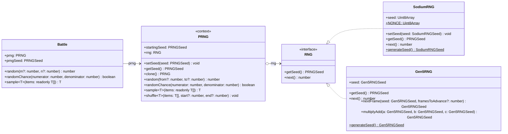
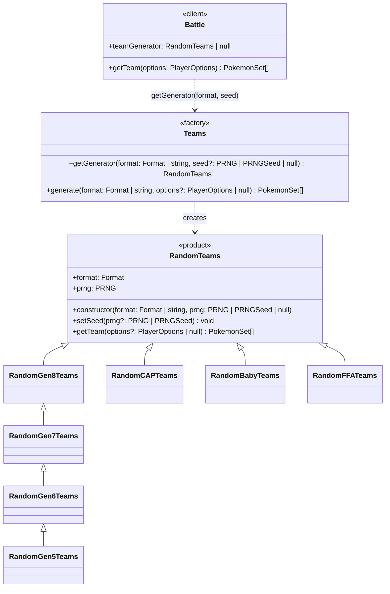
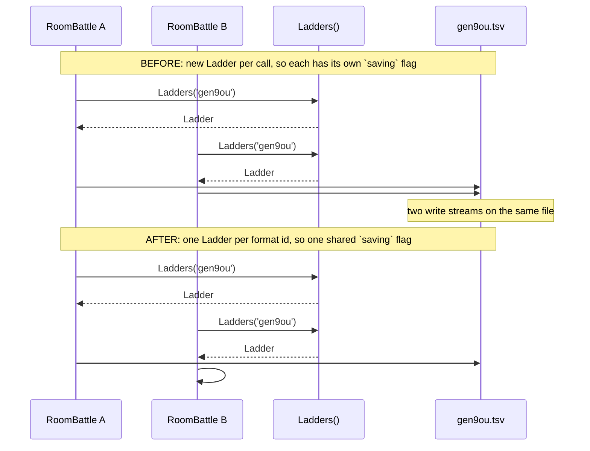

# Design Patterns

_CSCI 360 — Individual assignment. This page is built up part by part. **Parts 1–4 are below**; Part 5 follows in a later commit._

Diagram sources live in `/docs` (`pattern-*.mmd`). The code snippets are trimmed copies of the real code, with file and line references.

---

## Part 1: Three GoF Patterns Already in the Codebase

| # | Pattern | Where | Roles |
|---|---------|-------|-------|
| 1 | Strategy | `sim/prng.ts` | Context `PRNG`, Strategy `RNG`, concrete `SodiumRNG` / `Gen5RNG` |
| 2 | Observer | `sim/battle.ts`, `data/*.ts` | Subject `Battle`, subscription record `EventListener`, observers `Ability` / `Item` / `Condition` / `Species` |
| 3 | Factory Method (parameterized) | `sim/teams.ts`, `data/random-battles/*/teams.ts` | Factory `Teams.getGenerator`, product `RandomTeams`, concrete `RandomGen8Teams` / `RandomCAPTeams` / `RandomBabyTeams` / … |

I left Singleton out of Part 1 on purpose. It shows up in Part 2 instead, as a pattern the code is missing.

---

### 1. Strategy: interchangeable random number algorithms

**Roles**

| Role | Class |
|------|-------|
| Context | `PRNG` ([sim/prng.ts:41](../sim/prng.ts#L41)) |
| Strategy (interface) | `RNG` ([sim/prng.ts:26](../sim/prng.ts#L26)) |
| Concrete strategies | `SodiumRNG` ([:176](../sim/prng.ts#L176)), `Gen5RNG` ([:235](../sim/prng.ts#L235)) |
| Client | `Battle` ([sim/battle.ts:224](../sim/battle.ts#L224)) |

A `Gen3RNG` is sketched in a comment ([:313](../sim/prng.ts#L313)). It is not live code, so it is not in the diagram.

**Class diagram** (source: [pattern-strategy-prng.mmd](pattern-strategy-prng.mmd))



**Code**

```ts
// sim/prng.ts
interface RNG {
	getSeed(): PRNGSeed;
	next(): number;                      // random 32-bit number
}

export class PRNG {
	rng!: RNG;                           // the current strategy
	setSeed(seed: PRNGSeed) {
		if (seed.startsWith('sodium,'))      this.rng = new SodiumRNG(/* ... */);
		else if (seed.startsWith('gen5,'))   this.rng = new Gen5RNG(/* ... */);
		else throw new Error(`Unrecognized RNG seed ${seed}`);
	}
	random(from?: number, to?: number): number {
		const result = this.rng.next();      // algorithm-agnostic
		/* scale result into [0,1), [0,n) or [m,n) */
	}
}
```

**What it solves here**

A Showdown battle has to be exactly reproducible. The seed plus the choices are stored as an input log, and replays rebuild the battle from that log. Old logs were generated by the Gen 5 LCG. New battles use a ChaCha20-based generator. The seed string carries its own algorithm prefix (`sodium,…` or `gen5,…`), and `PRNG.setSeed` picks the matching strategy. `Battle` calls `prng.random()`, `randomChance()`, `sample()` and `shuffle()` and never learns which algorithm sits behind them.

Without the pattern, every random call in damage, accuracy, crit, speed ties and secondary effects would need to know which generator the replay used, or the old replays would stop reproducing. The file's own comment shows the payoff. `SodiumRNG` was rewritten from native libsodium to `ts-chacha20` ([:171](../sim/prng.ts#L171)) with no change to any caller. Adding a new algorithm means one class that implements two methods, plus one `else if` in `setSeed`.

---

### 2. Observer: effects subscribe to battle events

**Roles**

| Role | Class |
|------|-------|
| Subject | `Battle` (`runEvent`, `findEventHandlers`, [sim/battle.ts:758](../sim/battle.ts#L758)) |
| Subscription record | `EventListener` ([sim/battle.ts:89](../sim/battle.ts#L89)) |
| Observer contract | `EventMethods` ([sim/dex-conditions.ts:13](../sim/dex-conditions.ts#L13)) and the per-type handler shapes |
| Concrete observers | `Ability`, `Item`, `Condition`, `Species`, all extending `BasicEffect` |
| Observer state holders | `Pokemon`, `Side`, `Field`, which own the active effects |

**Class diagram** (source: [pattern-observer-battle-events.mmd](pattern-observer-battle-events.mmd))

```mermaid
classDiagram
    direction LR

    class Battle {
        <<subject>>
        +event: AnyObject
        +eventDepth: number
        +runEvent(eventid: string, target?: Pokemon | Pokemon[] | Side | Battle | null, source?: string | Pokemon | false | null, sourceEffect?: Effect | null, relayVar?: any, onEffect?: boolean, fastExit?: boolean) any
        +priorityEvent(eventid: string, target: Pokemon | Side | Battle, source?: Pokemon | null, effect?: Effect, relayVar?: any, onEffect?: boolean) any
        +findEventHandlers(target: Pokemon | Pokemon[] | Side | Battle, eventName: string, source?: Pokemon | null) EventListener[]
        +findPokemonEventHandlers(pokemon: Pokemon, callbackName: string, getKey?: 'duration') EventListener[]
        +resolvePriority(h: EventListenerWithoutPriority, callbackName: string) EventListener
        +speedSort~T~(list: T[], comparator?: (a: T, b: T) => number) void
    }

    class EventListener {
        <<subscription record>>
        +effect: Effect
        +callback?: Function
        +state: EffectState | null
        +effectHolder: Pokemon | Side | Field | Battle
        +end: Function | null
        +order: number | false
        +priority: number
        +subOrder: number
    }

    class EventMethods {
        <<observer contract>>
        +onDamagingHit?(damage: number, target: Pokemon, source: Pokemon, move: ActiveMove) void
        +onModifyAtk?(relayVar: number, source: Pokemon, target: Pokemon, move: ActiveMove) number | void
    }

    class BasicEffect {
        <<abstract>>
        +id: ID
        +name: string
        +effectType: EffectType
    }

    class Ability
    class Item
    class Condition
    class Species

    class Pokemon {
        +volatiles: EffectState[]
        +statusState: EffectState
        +abilityState: EffectState
        +itemState: EffectState
        +getAbility() Ability
        +getItem() Item
        +getStatus() Condition
    }

    Battle ..> EventListener : builds and notifies
    EventListener --> BasicEffect : effect
    BasicEffect <|-- Ability
    BasicEffect <|-- Item
    BasicEffect <|-- Condition
    BasicEffect <|-- Species
    EventMethods ..> Ability : handler signatures for
    EventMethods ..> Item : handler signatures for
    EventMethods ..> Condition : handler signatures for
    Battle o--> Pokemon
    Pokemon --> BasicEffect : holds subscribed effects
```



**Code**

```ts
// data/abilities.ts: an observer. It subscribes just by defining a property.
static: {
	onDamagingHit(damage, target, source, move) {
		if (this.checkMoveMakesContact(move, source, target)) {
			if (this.randomChance(3, 10)) source.trySetStatus('par', target);
		}
	},
	name: "Static",
},

// sim/battle.ts: the subject. It collects subscribers, orders them, notifies them.
runEvent(eventid, target, source, sourceEffect, relayVar, onEffect, fastExit) {
	const handlers = this.findEventHandlers(target, eventid, effectSource);
	this.speedSort(handlers);
	for (const handler of handlers) {
		returnVal = handler.callback.apply(this, args);   // notify
		if (returnVal !== undefined) relayVar = returnVal;
		if (!relayVar) break;                             // an observer can veto
	}
	return relayVar;
}
```

**What it solves here**

The simulator knows hundreds of abilities, items, moves' secondary conditions, weathers and statuses. `Battle` has no code that names any of them. When damage lands, it calls `runEvent('DamagingHit', …)`. `findPokemonEventHandlers` looks through the Pokémon's status, volatiles, ability, item, species and slot conditions for an `onDamagingHit` property. `Battle` then runs whatever it finds in speed and priority order.

Static, Rough Skin, Iron Barbs and the other effects that react to a hit are separate entries in `data/` that never refer to each other or to `Battle`. Without this, `Battle.damage()` would contain one growing `if (ability === 'static') … else if (item === 'rockyhelmet') …` chain per event, and every new ability would mean editing the core engine. As it is, adding an ability is a data-only change.

Two things differ from the textbook pattern. Subscription is implicit: an effect subscribes by defining a method named `on<Event>`, and `Battle` rebuilds the subscriber list on every event instead of keeping a registry. Observers can also return a value that changes the event's outcome, or veto it (`relayVar`, `fastExit`). That makes this part Chain of Responsibility as well.

---

### 3. Factory Method (parameterized): choosing the team generator for a format

**Roles**

| Role | Class |
|------|-------|
| Factory | `Teams.getGenerator` ([sim/teams.ts:628](../sim/teams.ts#L628)) |
| Product (base) | `RandomTeams` ([data/random-battles/gen9/teams.ts:151](../data/random-battles/gen9/teams.ts#L151)) |
| Concrete products | `RandomGen8Teams` → `RandomGen7Teams` → `RandomGen6Teams` → `RandomGen5Teams` → … → `RandomGen1Teams`, plus `RandomCAPTeams`, `RandomBabyTeams`, `RandomFFATeams` and about a dozen more |
| Client | `Battle.getTeam` ([sim/battle.ts:3175](../sim/battle.ts#L3175)), `Teams.generate`, `TeamValidator` ([sim/team-validator.ts:390](../sim/team-validator.ts#L390)) |

This is a parameterized factory, often called a Simple Factory. It is one method that takes a format and returns the right subclass. It is not the textbook version where subclasses override the creation step. Each product also loads its module lazily with `require`, so the server only loads the generators for formats that someone actually plays.

**Class diagram** (source: [pattern-factory-team-generators.mmd](pattern-factory-team-generators.mmd))



**Code**

```ts
// sim/teams.ts: the factory
getGenerator(format: Format | string, seed: PRNG | PRNGSeed | null = null) {
	let TeamGenerator;
	format = Dex.formats.get(format);
	const formatID = toID(format);
	if (format.mod === 'gen9ssb') {
		TeamGenerator = require(`../data/mods/gen9ssb/random-teams`).default;
	} else if (formatID.includes('gen9babyrandombattle')) {
		TeamGenerator = require(`../data/random-battles/gen9baby/teams`).default;
	} else if (formatID.includes('gen9freeforallrandombattle')) {
		TeamGenerator = require(`../data/random-battles/gen9ffa/teams`).default;
	} else {
		TeamGenerator = require(`../data/random-battles/${mod}/teams`).default;
	}
	return new TeamGenerator(format, seed);
}

// sim/battle.ts: the client only sees the RandomTeams interface
this.teamGenerator = Teams.getGenerator(this.format, options.seed);
team = this.teamGenerator.getTeam(options);
```

(The snippet drops some of the `else if` branches. The real method has six.)

**What it solves here**

Showdown has random battle formats for every generation (Gen 1 to Gen 9), plus variants such as CAP, Baby, Free-For-All, Let's Go and BDSP. Each one builds teams with different rules. Callers like `Battle.getTeam`, `Teams.generate` and the team validator just want "give me a team for this format". They call `getGenerator(format, seed)` and then `getTeam()`. They never import a specific generator, never check the generation, and never construct one.

Without the factory, every caller would need its own copy of the format-to-generator mapping. A new format would mean finding and editing each of them, and a missed caller would fail only at runtime. Because the lookup lives in one place, adding a format is a new `teams.ts` file plus one branch in `getGenerator`.

The factory is also not clean. It is a growing `if/else` chain keyed on format-ID strings, and that is a real weakness. I'm leaving it out of Part 2 on purpose and treating it only as a pattern that exists here.

---

## Part 2: A Missing Pattern: Singleton for `Ladders`

### Where

`Ladders(formatid)` is how the server gets the ladder for a format. It is called when a rated battle ends (`RoomBattle.updateLadder`), for `/search`, for challenges, for tournaments and for the ladder top list. Despite looking like a lookup, it built a new object every time ([server/ladders.ts:483](../server/ladders.ts#L483), before the change):

```ts
function getLadder(formatid: string) {
	return new Ladder(formatid);      // a brand-new object on every call
}
```

`Ladder extends LadderStore`. With the local ladder, which is the default when `Config.remoteladder` is off, `LadderStore` owns writing `config/ladders/<format>.tsv`, and it guards that write with a per-instance flag ([server/ladders-local.ts:87](../server/ladders-local.ts#L87)):

```ts
async save() {
	if (this.saving) return;          // "someone is already saving, back off"
	this.saving = true;
	/* ... write config/ladders/<format>.tsv ... */
	this.saving = false;
}
```

### The concrete problem

The ladder rows are already shared by every instance through a module-level `ladderCaches` map ([ladders-local.ts:27](../server/ladders-local.ts#L27)). The lock that protects writing those rows is not shared, because `this.saving` lives on each throwaway object. Since every caller gets its own `Ladder`, no `save()` can ever see another one's `saving = true`, so the lock can never block anything.

When two rated battles in the same format end at nearly the same time, both `updateRating → save()` calls pass the check and both open a write stream on the same `.tsv` file:

(source: [pattern-singleton-ladders.mmd](pattern-singleton-ladders.mmd))



### The pattern that fixes it

**Singleton, one instance per format.** `Ladders(formatid)` keeps a registry and always returns the same `Ladder` for a given format id. Strictly speaking, that keyed form is sometimes called a Multiton: there is one instance per format, not one in the whole program. The idea is the same. Callers don't construct the object. They ask for *the* instance, and the class guarantees there is only one.

### GRASP

- **Violated now: High Cohesion and Information Expert.** The data (`ladderCaches`, module-level) and the lock that protects it (`saving`, per throwaway instance) live in different places. No single object owns "the Gen 9 OU ladder file", so no object is in a position to protect it.
- **Restored: Information Expert.** After the change, there is exactly one object per format that owns both the rows and the lock. The object that knows about the file is the one that controls writing it.

---

## Part 3: Implementation

**Commit:** `A8: Apply Singleton to Ladders` (see the [history of server/ladders.ts](https://github.com/jovannysv/pokemon-showdown/commits/master/server/ladders.ts))

### Before

```ts
// server/ladders.ts
function getLadder(formatid: string) {
	return new Ladder(formatid);
}
```

### After

```ts
// server/ladders.ts
/**
 * One Ladder per format, so every caller shares the same instance (and the
 * same `saving` lock in LadderStore) instead of each getting its own.
 *
 * Only exact format ids are cached. Custom-rule challenges and unrecognized
 * strings come from user input, so they get a throwaway instance instead of
 * growing the cache.
 */
const ladders = new Map<string, Ladder>();

function getLadder(formatid: string) {
	const format = Dex.formats.get(formatid);
	if (!format.exists || format.id !== formatid) return new Ladder(formatid);
	let ladder = ladders.get(format.id);
	if (!ladder) {
		ladder = new Ladder(format.id);
		ladders.set(format.id, ladder);
	}
	return ladder;
}
```

None of the callers changed. `Ladders('gen9ou').updateRating(...)` reads exactly as before.

### Design decisions

- **Only real format ids are cached.** `Ladders()` receives user input: `/search <anything>`, challenge formats with custom rules like `gen9ou@@@!Team Preview`, and tournament formats. Caching every string would let any user grow the map without limit. With this rule, the cache can hold at most one entry per real format. Anything else gets a throwaway instance, which is exactly the old behavior. Normal ladder battles, which are what write the rating files, use plain format ids, so they get the shared instance.
- **Sharing is safe.** `Ladder.prepBattle` sets `this.formatid = Dex.formats.validate(this.formatid)`. For a plain format id, `validate` returns `format.id` unchanged ([sim/dex-formats.ts:718](../sim/dex-formats.ts#L718)), so a cached instance is never altered. The remote `LadderStore` only holds `formatid`, so sharing it is harmless too.

### Verification

- `npx tsc`: no errors. `npx eslint server/ladders.ts test/server/ladders.js`: clean.
- Two new tests in `test/server/ladders.js`: the same format returns the same instance, and custom-rule or unknown formats are not cached.
- Full mocha suite: **2369 passing, 74 pending**, compared with 2367 passing before the change (the +2 are the new tests).
- The server starts and listens (`node pokemon-showdown start`).

### What is now easier to change

Anything that needs per-format shared state now has one obvious home. A save queue, a write debounce, an in-memory leaderboard or per-format rate limiting can go on the `Ladder` instance and will automatically be shared by every caller. Before, any of those added to `Ladder` would have been silently split across throwaway copies, just like the `saving` flag was.

---

## Part 4: A GRASP Refactoring: Low Coupling in the `/timer` command

**Commit:** `A8-GRASP: Refactor RoomBattleTimer to apply Low Coupling`

### The violation

The `/timer` chat command ([server/chat-commands/core.ts](../server/chat-commands/core.ts), `timer`) is a controller. It should take the user's input and pass it on. Instead it reached through three objects (command → `room` → `game` → `timer`) into the timer's private `Set` of requesters, and needed an `as any` cast to do it. It then worked out the timer's state itself.

### Before

```ts
// server/chat-commands/core.ts: timer()
const timer = room.game.timer as any;               // type safety switched off
if (!timer.timerRequesters) {                       // "is this a battle timer?"
	return this.sendReply(this.TL`This game's timer is managed by a different command.`);
}
if (!target) {
	if (!timer.timerRequesters.size) {              // "is it on?"
		return this.sendReply(this.TL`The game timer is OFF.`);
	}
	const requester = [...timer.timerRequesters].join(', ');   // "who asked?"
	return this.sendReply(this.TL`The game timer is ON (requested by ${requester})`);
}
// ...
if (timer.timerRequesters.size) {                   // "is it on?" again
	timer.stop(force ? undefined : user);
```

### After

```ts
// server/room-battle.ts: RoomBattleTimer answers questions about its own state
isOn() {
	return this.timerRequesters.size > 0;
}
/** Comma-separated userids of everyone who asked for the timer, for status messages. */
listRequesters() {
	return [...this.timerRequesters].join(', ');
}

// server/chat-commands/core.ts: timer() just asks
const timer = room.battle?.timer;                   // typed RoomBattleTimer, no cast
if (!timer) {
	return this.sendReply(this.TL`This game's timer is managed by a different command.`);
}
if (!target) {
	if (!timer.isOn()) {
		return this.sendReply(this.TL`The game timer is OFF.`);
	}
	return this.sendReply(this.TL`The game timer is ON (requested by ${timer.listRequesters()})`);
}
// ...
if (timer.isOn()) {
	timer.stop(force ? undefined : user);
```

### What moved and why it's better

The "is the timer on, and who turned it on" logic moved out of the `/timer` command and into `RoomBattleTimer`, the class that owns the `timerRequesters` set (Information Expert). The command now depends only on two small, typed methods instead of the timer's internal data structure (Low Coupling). That also removed the `as any` cast, so the compiler checks this code again. If the timer ever changes how it tracks requesters, for example from a `Set` to a map with timestamps, only `RoomBattleTimer` changes and the command keeps working.

### Notes

- `room.battle` is set by `RoomBattle`'s constructor, and `RoomBattle` is the only game whose timer has requesters. Other games, like Trivia and UNO, store a plain `NodeJS.Timeout`. So `room.battle?.timer` picks out exactly the same case the old `!timer.timerRequesters` check did, and other games still get "managed by a different command".
- I left the base `RoomGame.timer` type alone. Narrowing it would change the `@ts-expect-error` lines in `rooms.ts`, which would make this commit bigger than one refactoring.

### Verification

- `npx tsc`: no errors. `npx eslint` on the three changed files: clean.
- New test in `test/server/room-battle.js`: starting and stopping the timer is reflected in `isOn()` and `listRequesters()`.
- Full mocha suite: **2370 passing, 74 pending** (2369 before; the +1 is the new test).

---

_Part 5 (GoF vs GRASP) is not written yet._
