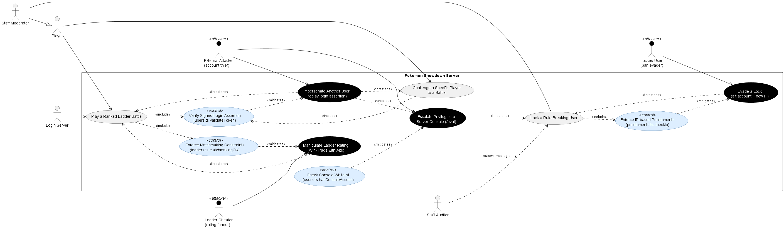
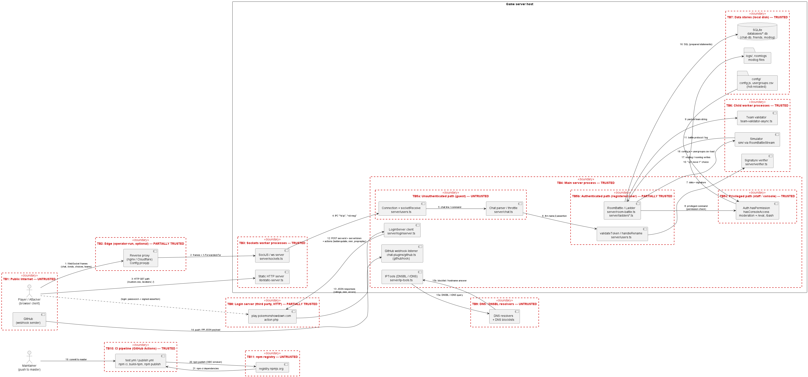

# Security Analysis

**Project:** Pokémon Showdown (server repository, `smogon/pokemon-showdown`)
**Course:** CSCI 360 — Software Architecture, Security, and Testing

All findings below come from reading the source in this fork. Nothing was run against `play.pokemonshowdown.com` or any other public deployment.

---

## Part 1: Misuse Case Diagram

This extends the A1b use case diagram ([docs/use-case-diagram.puml](use-case-diagram.puml)). The three original use cases and four original actors are unchanged. Added:

- **Three attacker actors**, drawn outside the system boundary: a *Ladder Cheater*, a *Locked User* trying to evade punishment, and an *External Attacker* who has stolen or is trying to steal an account.
- **Four misuse cases** (black), each the inverse of a normal use case.
- **Four controls** (blue). Each is a security use case that already exists in the code, labelled with the function that implements it.
- Labelled relationships: `<<threatens>>` (misuse → use case), `<<mitigates>>` (control → misuse case), `<<include>>` (use case → the control it runs), and one `<<enables>>` (one misuse case is a stepping stone to another).

Source: [docs/misuse-case-diagram.puml](misuse-case-diagram.puml)



| Misuse case | Inverse of | Threatens | Mitigated by (existing control) |
|---|---|---|---|
| MUC1 Manipulate Ladder Rating (win-trade with alts) | UC1 Play a Ranked Ladder Battle | UC1 | `Ladder.matchmakingOK()`, `server/ladders.ts:332` |
| MUC2 Escalate Privileges to Server Console (`/eval`) | UC3 Lock a Rule-Breaking User (staff authority) | UC3, and the whole host | `User.hasConsoleAccess()`, `server/users.ts:619` |
| MUC3 Evade a Lock (alt account + new IP) | UC3 Lock a Rule-Breaking User | UC3 | `Punishments.checkIp()`, `server/punishments.ts:1724` |
| MUC4 Impersonate Another User (replay a login assertion) | UC1/UC2 log in as yourself | UC1, UC2 | `User.validateToken()`, `server/users.ts:638` |

**Why MUC4 `<<enables>>` MUC2.** The console check needs two things: the `console` permission, which only belongs to the account, and a whitelisted IP. An attacker who takes over an admin account already has the first one. That is why MUC2's preconditions (Part 2) start with an account takeover.

**How strong each mitigation is, from reading the code:**

- **C4 (assertion verification) is strong.** A login assertion is bound to the per-connection challenge string (`users.ts:683`), to the userid (`users.ts:677`), to an expiry (`users.ts:691`, default 25 h) and to an RSA signature from the login server (`users.ts:697` → `server/verifier.ts`). Replaying an assertion captured from someone else's connection fails the challenge check. That pushes MUC4 back to the login server's password and session cookie, which are outside this repository.
- **C1 (matchmaking constraints) is weak.** It only compares exact IP strings and the single most recent opponent. Part 2 shows how to get around it.
- **C3 (IP punishments) is partial.** It catches the same IP, banned ranges, and hosts classified as proxies (`IPTools.lookup` → `#hostfilter` lock). A residential or mobile IP that has not been seen before passes.
- **C2 (console whitelist) is strong by default and weak when misconfigured.** Part 2 explains why.

---

## Part 2: Two Fully-Dressed Misuse Cases

### MUC1: Manipulate Ladder Rating by Win-Trading with Alt Accounts

| Field | Detail |
|---|---|
| **Misuse case** | MUC1 Manipulate Ladder Rating |
| **Threatens** | UC1 Play a Ranked Ladder Battle |
| **Primary attacker** | **Ladder Cheater.** A registered player who wants a top-ladder rank (leaderboard visibility, bragging rights, standing for tournament or team selection) without winning real games. Medium skill: no exploit code needed, just two devices and a few free accounts. |
| **Attacker's goal** | Raise the Elo/GXE of a main account by feeding it wins from accounts the attacker controls. |
| **Scope / level** | Pokémon Showdown game server: ladder subsystem (`server/ladders.ts`, `server/room-battle.ts`, `server/ladders-remote.ts`). |

**Preconditions**

1. The attacker controls at least three registered accounts: main account **A** and alts **B** and **C**. Registration on the login server is free.
2. The attacker has two network connections with **different public IPs** that the host filter does not classify as proxies, for example home broadband and a phone hotspot. (VPN/datacenter IPs get `#hostfilter`-locked at `punishments.ts:1761`, so the attacker avoids them.)
3. The target format is rated (`format.rated !== false`) and has low queue traffic, so the attacker's accounts are likely to be paired with each other rather than with strangers.
4. `Config.noipchecks` is `false` (the default). If it is `true`, `matchmakingOK` skips the IP and repeat-opponent checks entirely (`ladders.ts:340`), and precondition 2 is not needed.

**Attack scenario**

1. The attacker logs in as **A** on device 1 (IP₁) and as **B** on device 2 (IP₂).
2. Both accounts select the same low-traffic rated format, submit any legal team, and click *Battle!* within a few seconds of each other. `Ladder.searchBattle()` (`ladders.ts:311`) validates each team and fetches each rating.
3. `Ladder.addSearch()` calls `matchmakingOK()` (`ladders.ts:332`). Every check passes: the users are different objects (`:338`), `latestIp` differs (`:347`), neither has a `lastMatch` (`:350`), and both new accounts are near 1000, so the gap is within `searchRange` (`:355–365`). A rated battle room is created.
4. On turn 0, **B** types `/forfeit`. `RoomBattle.forfeitPlayer()` (`room-battle.ts:1046`) ends the battle with A as the winner.
5. `RoomBattle.onEnd` sees `this.room.rated` and calls `updateLadder()` (`room-battle.ts:856`). Nothing checks how many turns were played. `Ladders.updateRating()` (`ladders-remote.ts:64`) sends `ladderupdate` to the login server, and A gains rating.
6. The attacker re-queues. `lastMatch` now blocks A vs B, so **C** (on IP₂) queues instead of B. Steps 3–5 repeat with C forfeiting.
7. With A's `lastMatch` now set to C, the A vs B pairing is allowed again. The attacker alternates B and C indefinitely.
8. As A climbs and the alts sink, the rating gap grows. The attacker lets the alt sit in queue longer: `searchRange` grows by +1 per 0.3 s and is capped at 600 (`ladders.ts:362–364`), so gaps of up to 600 points still match. When the gap exceeds 600, the attacker registers a fresh alt at 1000 (back to precondition 1).
9. A reaches the top of the ladder.

**Extensions (alternate paths)**

- 3a. A stranger searching at the same moment is paired instead. The attacker cancels or plays the game normally and retries in a quieter time slot.
- 4a. The attacker would rather avoid a visible turn-0 forfeit. The alt lets the turn timer run out instead (`room-battle.ts:462`, "lost due to inactivity"). The result is the same.

**Intervention points**

| Step | What could have stopped it | Control and where it belongs |
|---|---|---|
| 1 | Linking A, B and C as one person. | The game server already records every account's IPs. A check in `matchmakingOK` could reject pairs that have **ever** shared an IP in the session history, not only the current `latestIp`. Owned by `server/ladders.ts`. |
| 3 | The pairing check is too narrow: exact IP string and only the last opponent. | Keep a per-user history of the last *N* rated opponents (or a per-pair daily cap on rated games) and compare IPs at subnet level using `IPTools` (`/24` for IPv4, `/64` for IPv6). Belongs in `Ladder.matchmakingOK()`, because that is the only place both players are known before a rated room exists. |
| 5 | A turn-0 forfeit still counts as a rated result. | In `RoomBattle.onEnd`, skip `updateLadder()` (or score it as unrated) when `endType === 'forfeit'` and `battle.turn` is below a small threshold. Belongs in `server/room-battle.ts`, because that layer knows how the game ended. The ladder layer only receives a score. |
| 8 | The search range widening to 600 lets very lopsided pairs match. | A lower cap for repeat pairings, enforced in `matchmakingOK`. |
| after 9 | Spotting the pattern after the fact. | Offline detection over battle logs (`logBattle`): many short, forfeit-ended rated games between the same small set of accounts. This cannot prevent the attack, but it supports a rating reset and a punishment. |

**Consequence**

- **Attacker gains:** a top-ladder rank and the reputation that comes with it. The rank may be used for invitations, team selection, or selling a high-rated account.
- **System and users lose:** the integrity of the public ladder. Legitimate players are pushed down. Ratings stop meaning anything for matchmaking, so honest players near the inflated account get mismatched. Moderator time goes to manual investigations.

---

### MUC2: Escalate Privileges to the Server Console (`/eval`)

| Field | Detail |
|---|---|
| **Misuse case** | MUC2 Escalate Privileges to Server Console |
| **Threatens** | UC3 Lock a Rule-Breaking User (the staff authority model as a whole) and the host machine itself |
| **Primary attacker** | **External Attacker.** Has taken over the account of a server administrator (`~` rank, which holds the `console` permission), for example through credential stuffing against the login server or a phished password. High skill and high motivation. |
| **Attacker's goal** | Run arbitrary JavaScript inside the server process via `>>` / `/eval`, and from there shell commands via `/bash`. That means full control of the server, its data and its host. |
| **Scope / level** | Game server: connection layer (`server/sockets.ts`), user/permission layer (`server/users.ts`, `server/user-groups.ts`), chat command layer (`server/chat.ts`, `server/chat-commands/admin.ts`). |

**Preconditions**

1. The attacker can log in as an account whose group holds `console`, typically a global administrator. (This is MUC4 succeeding, or a credential stolen at the login server.)
2. The deployment sits behind a reverse proxy (nginx, Cloudflare, a load balancer) with `Config.proxyip` (`config/config-example.js:85`) set, and one of these misconfigurations is present:
   - (a) the proxy passes the client's `X-Forwarded-For` through **without appending** the real client IP, or
   - (b) `proxyip` is **too broad** (for example a whole cloud provider range) and the attacker connects from inside that range.
3. `Config.consoleips` (`config/config-example.js:414`) still contains an IP address, for example the default `'127.0.0.1'`, rather than only userids or `[]`.

**Attack scenario**

1. The attacker logs in as the compromised admin account. `User.validateToken()` (`users.ts:638`) accepts the genuine assertion the login server signs, and `handleRename()` assigns the account its `~` group.
2. The attacker types `>> 1+1`. `CommandContext.canUseConsole()` (`chat.ts:1115`) calls `User.hasConsoleAccess()` (`users.ts:619`). `this.can('console')` passes (`:621`), but `connection.ip` is the attacker's real IP, which is not in `consoleips` (`:625`). The command is refused. The attacker now knows the IP whitelist is the only thing in the way.
3. The attacker opens a new WebSocket connection to the server through the misconfigured proxy, adding the header `X-Forwarded-For: 127.0.0.1`.
4. In `ServerStream` (`sockets.ts:466–476`), `socket.remoteAddress` is the proxy, so `isTrustedProxyIp()` returns true. The code reverses the `X-Forwarded-For` list and takes the first (rightmost) entry it does *not* trust as the client IP. Under 2(a) the header is just `127.0.0.1`, so that entry is selected. Under 2(b) the header is `127.0.0.1, <attacker IP>`: the attacker IP is skipped as a "trusted proxy" and `127.0.0.1` is selected next. Either way, `connection.ip` becomes `127.0.0.1`.
5. The attacker logs in to the admin account on this new connection and sends `>> 1+1` again. `hasConsoleAccess()` now finds `'127.0.0.1'` in the whitelist and returns true.
6. `/eval` (`chat-commands/admin.ts:1524`) runs `eval(target)` (`:1545`) inside the server process. The attacker reads `Config` (login server key, database credentials), dumps `Users`, and edits `Punishments`.
7. The attacker runs `/bash` (same file) to get a shell on the host. From there they can plant persistence, for example by editing `config/config.js`, which is hot-reloaded because `Config.watchconfig` defaults to `true` (`config-example.js:422`).
8. To hide what they did, the attacker uses `>>` to clear or rewrite modlog and room log entries. The input is logged to the `upperstaff` room (`admin.ts:1527`), but that log lives in the same process the attacker now controls.

**Extensions**

- 2a. `consoleips` contains the admin's **userid** rather than an IP. Step 2 succeeds immediately and steps 3–5 are not needed. Account takeover alone is then full RCE.
- 1a. The compromised account has the `isSysop` flag (login server userType `'3'`, `users.ts:825`) and `Config.backdoor` is `true` (the default, `config-example.js:400`). `hasSysopAccess()` short-circuits the whole check (`users.ts:620`), so no IP spoofing is needed. This path relies entirely on trusting the login server's signature.

**Intervention points**

| Step | What could have stopped it | Control and where it belongs |
|---|---|---|
| 1 | Stolen credentials work. | Two-factor authentication or a re-authentication challenge for staff accounts. Belongs on the **login server**, which owns credentials. The game server only checks signatures and cannot tell a stolen password from a real one. |
| 2 | (Working as intended.) The IP whitelist blocked the first attempt. | `User.hasConsoleAccess()`. This failure should also raise an alert (`Monitor.warn`), because an admin hitting the console check from an unexpected IP is a strong signal. |
| 4 | **Main intervention point.** A client-supplied header is believed. | In `sockets.ts`, a connection whose resolved IP is loopback or private but which arrived through a proxy (`remoteAddress !== socketip`) should never be treated as loopback. Separately, the config loader (`server/config-loader.ts`) should refuse a `proxyip` wider than a sane prefix. That validation belongs in the config loader because it is the one place every deployment's config passes through at startup. |
| 5 | Loopback is used as proof of identity. | `hasConsoleAccess()` should compare against the **socket's real `remoteAddress`**, not the `X-Forwarded-For`-derived `connection.ip`. Console access is a privilege decision, so it must not depend on data the client can influence. |
| 6–7 | Unrestricted `eval` and shell access. | Disable `/eval` and `/bash` in production (`consoleips = []`) and do maintenance over SSH, which has its own authentication. This is an operator decision in `config/config.js`. |
| 8 | Logs live inside the compromised process. | Ship modlog and console-command logs to an append-only store outside the server process. |

**Consequence**

- **Attacker gains:** arbitrary code execution as the OS user that runs the server, and possibly the host. They can read the login server public key setup, database credentials, every connected user's IP (`Users`), and all private messages and logs. They can grant or remove any rank and lock or unlock anyone.
- **System and users lose:** confidentiality (IPs, PMs, punishment records), integrity (ladders, punishments, auth groups, replays can all be rewritten), availability (the attacker can stop the server), and accountability (logs can be wiped). UC3 becomes meaningless, because the attacker can undo any lock and lock the real staff.

---

## Part 3: Trust Boundary Diagram

Source: [docs/trust-boundary-diagram.puml](trust-boundary-diagram.puml)



### Components and boundaries

Pokémon Showdown is not one trust zone. It runs as **several OS processes** (`lib/process-manager.ts`) and talks to **three kinds of outside party**. Each red dashed box in the diagram is a place where the level of trust changes.

Each zone gets one of three trust levels:
- **Untrusted:** controlled by someone outside the project, or by any member of the public. Everything coming from it must be validated.
- **Partially trusted:** run by the operator or a known party, or identity is verified but behaviour is not. It is believed for some purposes but should still be checked.
- **Trusted:** the project's own code or the operator's own host. It is believed without checks.

The last column records how the **code actually treats** the zone. Wherever that is more trusting than the zone deserves, there is a finding.

| Boundary | What is on the inside | Trust level | How the code treats it | Why trust changes here |
|---|---|---|---|---|
| **TB1** Public internet | Browser clients (players and attackers alike), GitHub | **Untrusted** | Untrusted ✔ (size caps, throttles, filters at crossings 1, 3, 5) | Anyone can send anything. |
| **TB2** Edge | Optional reverse proxy | **Partially trusted** (operator infrastructure, but it forwards client-written headers) | **Trusted** ✘ (any `X-Forwarded-For` value is believed once the proxy IP matches `proxyip`) | Operator-run, but it adds a header that the server is configured to believe. *Mismatch, so it is a finding (R1).* |
| **TB3** Sockets workers | `server/sockets.ts`, `lib/static-server.ts` | **Trusted** (project code, same host) | Trusted ✔ | Separate processes that hold the raw sockets. The main process never touches a socket directly. |
| **TB4** Main server process | Users, rooms, chat, ladders, punishments | **Trusted** (project code, same host) | Trusted ✔ | Holds all global state. |
| **TB5a** Guest path, inside TB4 | Unnamed or unregistered connections | **Untrusted** (anyone, unidentified) | Untrusted ✔ (all chat validation applies) | Which code an incoming line can reach depends on who is sending it. |
| **TB5b** Registered path, inside TB4 | Users with a verified login assertion | **Partially trusted** (identity verified, intent not) | Partially trusted ✔ (identity accepted, every command still permission-checked) | Same process, but more commands become reachable. |
| **TB5c** Privileged path, inside TB4 | Staff ranks; console users | **Trusted** (vetted staff) | Trusted, with console gated by IP ✘ (the IP comes from TB2) | Same process, but staff commands and `/eval` become reachable. |
| **TB6** Child workers | Simulator, team validator, signature verifier | **Trusted** (project code, isolated for stability, not security) | Trusted ✔ (output relayed without checks, crossing 11) | Separate processes that receive only strings over IPC. A crash or hang there should not take down TB4. |
| **TB7** Local data stores | SQLite `databases/*.db`, `logs/`, `config/` | **Trusted** (operator's own disk) | Fully trusted ✔ (`config.js` executed, `usergroups.csv` read verbatim) | Disk state that outlives the process. `config/config.js` is *executable code*. |
| **TB8** Login server | `play.pokemonshowdown.com/action.php` | **Partially trusted** (a known party, but reached over a network the server does not control) | **Trusted** ✘ (responses only parsed as JSON, no TLS by default; assertions relayed by clients *are* verified) | A separate service in a separate repository. It owns passwords and the ladder database. *Mismatch, so it is a finding (R2).* |
| **TB9** DNS / DNSBL | System resolvers and blocklists | **Untrusted** (third party, unauthenticated protocol) | **Trusted** ✘ (answers decide semilocks and host-filter locks, no DNSSEC) | Third-party answers used to make punishment decisions. *Mismatch, low impact.* |
| **TB10** CI pipeline | GitHub Actions `test.yml`, `publish.yml` | **Trusted** (project-controlled) | Trusted ✔ (gated only by branch protection on `master`) | Builds and publishes the npm package. |
| **TB11** npm registry | registry.npmjs.org | **Untrusted** (third party; packages written by strangers) | Partially trusted (lockfile integrity hashes pin *what* is installed, not *whether it is safe*; see Part 6) | Source of every dependency, and where releases are published. |

**Summary:** four zones are untrusted (TB1, TB5a, TB9, TB11), three are partially trusted (TB2, TB5b, TB8), and six are trusted (TB3, TB4, TB5c, TB6, TB7, TB10). The code trusts three zones more than it should: TB2, TB8 and TB9. TB5c inherits the TB2 problem through its IP check.

### Crossings (the attack surface)

**Bold "Nothing"** marks a finding: a crossing where nothing checks the data, or where the only check depends on operator configuration.

| # | Crossing | Data | What is validated, and by whom |
|---|---|---|---|
| 1 | Client → Proxy/Sockets (TB1→TB2/3) | WebSocket frames | `sockets.ts:481–490` drops empty frames, frames over 100 KB, and legacy JSON. **No transport encryption by default**: `Config.ssl = null` and `bindaddress = '0.0.0.0'` (`config-example.js:16,56`). TLS is entirely up to the operator. |
| 2 | Proxy → Sockets (TB2→TB3) | `X-Forwarded-For` header → client IP | The header is only read if `socket.remoteAddress` is in `Config.proxyip` (`sockets.ts:467`). The rightmost untrusted entry is then taken. **Nothing** checks that the entry is a well-formed IP, and nothing rejects loopback or private addresses. This is the root of MUC2. |
| 3 | Client → Static server (TB1→TB3) | HTTP URL path | `sockets.ts:340–360` routes only `/custom.css`, `/avatars/*`, and room-id paths. `StaticServer.servePath` rejects paths that resolve outside the root with a `startsWith(root)` check (`lib/static-server.ts:193–197`). |
| 4 | Sockets worker → Main (TB3→TB4) | IPC lines `*socketid\nip`, `<socketid\nmessage` | **Nothing**: `Sockets.onSpawn` (`sockets.ts:31–56`) splits on `\n` and trusts the worker. This is acceptable because both are the same codebase on the same host, but it means the IP attached to every connection is exactly whatever crossing 2 produced. |
| 5 | Raw message → chat/command layer (TB5a) | `ROOMID` + `\|` + text | `socketReceive` (`users.ts:1685`) requires a pipe and caps lines per message (`users.ts:1729`). `User.chat` throttles (`users.ts:1431–1460`). `CommandContext` enforces a 1000-character limit (`chat.ts:1316`), banwords (`chat.ts:1340`) and filters. Guests reach this layer, so all of these apply before login. |
| 6 | Guest → Registered (TB5a→TB5b) | `/trn name,0,assertion` | **Strong.** `User.validateToken` (`users.ts:638–710`) checks the legal host, userid binding, per-connection challenge binding, expiry (25 h default), and the RSA signature. The only bypass is `Config.noguestsecurity` (`config-example.js:463`, default `false`). |
| 7 | Main → Verifier worker (TB4→TB6) | Assertion data + signature | The verifier (`verifier.ts:20–28`) uses `Config.loginserverpublickey`, so only assertions signed with the login server's private key pass. Note that the configured algorithm is **RSA-SHA1** (`config-example.js:192`), a deprecated hash. |
| 8 | Registered → Staff/Console (TB5b→TB5c) | Any privileged command | Every command calls `checkCan` (`chat.ts:463`) → `Auth.hasPermission` (`user-groups.ts:113`), which uses the group from `config/usergroups.csv` or the login server's userType. The console additionally requires `hasConsoleAccess` (`users.ts:619`), which trusts `connection.ip` from crossing 2. |
| 9 | Main → Team validator (TB4→TB6) | Packed team string | A size cap of about 25 KB is enforced *before* IPC (`team-validator-async.ts:58`). Full legality is checked by `TeamValidator.validateTeam` in the worker (`team-validator-async.ts:25`). |
| 10 | Main → Simulator (TB4→TB6) | `>p1 <choice>` | **Two layers.** `RoomBattle.choose` (`room-battle.ts:624–646`) takes the slot from the server-side `playerTable[user.id]`, so a client cannot move for its opponent, and checks the request id is current. `Side.choose` (`sim/side.ts:1185+`) then validates the choice against the battle state. |
| 11 | Simulator → Main (TB6→TB4) | Battle protocol | **Nothing** at the boundary: output is split by channel (`extractChannelMessages`) and relayed to clients. It is trusted because user-controlled strings (nicknames) were already filtered at crossing 9. |
| 12 | Main → Login server (TB4→TB8) | `serverid`, **`servertoken`**, actions | **Nothing protects transport.** `LoginServerInstance.makeRequests` (`loginserver.ts:132–141`) POSTs to `Config.loginserver`, which defaults to **`http://`** (`config-example.js:191`). The server's shared secret travels in cleartext. |
| 13 | Login server → Main (TB8→TB4) | JSON responses (`mmr`, `ladderupdate`, replay results) | **Only "does it parse as JSON"** (`loginserver.ts:143`). There is no signature and, by default, no TLS. `Ladder.getRating` turns the `mmr` response into the rating used for matchmaking (`ladders-remote.ts:44–55`). *This is the main "trusts what it should verify" finding; see below.* |
| 14 | GitHub → Webhook listener (TB1→TB4) | Push / PR JSON | `githubhook` checks an HMAC-SHA1 `X-Hub-Signature` **only if `Config.github.secret` is set** (`node_modules/githubhook/index.js:96–107`). `config-example.js` documents no secret, so by default **nothing** authenticates the sender. The comparison is also a plain `!==`, not constant-time. Output is HTML-escaped with `Utils.html` before it is posted into rooms (`chat-plugins/github.ts`), which limits a forged payload to spoofing announcements. |
| 15 | IPTools ↔ DNS/DNSBL (TB4↔TB9) | DNSBL and reverse-DNS answers | **Nothing** (no DNSSEC). The answers decide `#dnsbl` semilocks and `#hostfilter` locks (`punishments.ts:1758–1764`). A spoofed answer can wrongly semilock or un-flag a user, but cannot grant privileges. |
| 16 | Main → SQLite (TB4→TB7) | SQL | All queries use prepared statements with bound parameters. A grep for `` prepare(`...${ `` or `` exec(`...${ `` in `server/` and `lib/` finds **no** string-interpolated SQL. Schemas are loaded from `databases/schemas/*.sql` (`friends.ts:93`). |
| 17 | Main → Logs (TB4→TB7) | Modlog, roomlogs | Written by the same process with no integrity protection. Anyone with code execution in TB4 (MUC2) can rewrite history. |
| 18 | `config/` → Main (TB7→TB5c) | `config.js` (executed), `usergroups.csv` (ranks) | **Nothing.** The config is `require()`d and hot-reloaded when `watchconfig` is `true` (the default), and `usergroups.csv` is read verbatim (`user-groups.ts:356`). Anyone with write access to `config/` gets code execution and can grant any rank. Filesystem permissions are the only control. |
| 19 | Maintainer → CI (TB10) | Commit to `master` | `publish.yml` runs `test.yml` and then publishes whenever the `package.json` version changes. GitHub branch protection (configured outside the repo) is the only gate. |
| 20 | CI → npm (TB10→TB11) | Published package | `publish.yml` uses `permissions: id-token: write` and an `npm` environment, i.e. OIDC trusted publishing instead of a long-lived token. Analysed in Part 6. |
| 21 | npm → CI / server (TB11→TB10) | Dependencies | `npm ci` checks `package-lock.json` integrity hashes. Analysed in Part 6. |

### One place the project trusts what it should verify: login server responses (crossings 12–13)

**What is trusted.** The game server treats every byte that comes back from `Config.loginserver` as authoritative. The only test is that it is JSON (`loginserver.ts:143`). With the shipped default of `http://play.pokemonshowdown.com/` (`config-example.js:191`), that traffic crosses the network unencrypted and unauthenticated. The login assertions that arrive via the *client* are RSA-signed and carefully checked (crossing 6). The responses the server fetches *itself* are not signed at all. The project verifies the channel it does not control (the client) more carefully than one it assumes it controls (its own HTTP request), but that request also travels over a network it does not control.

**What would happen if that trust were misplaced.** Consider an attacker who can observe or alter traffic between the game server and the login server: someone on a shared hosting network, a compromised router, or a hostile DNS resolver returning a different IP for the login server host.

1. **Credential theft (crossing 12).** Every request carries `servertoken` in the POST body. Once captured, the attacker can call `action.php` *as that game server*: submit `ladderupdate` results for battles that never happened, upload replays, or invalidate CSS. That is ladder tampering without ever playing (MUC1 at scale).
2. **Response forgery (crossing 13).** By rewriting the `mmr` response, the attacker controls the rating that `Ladder.getRating` caches (`ladders-remote.ts:44–55`). Since `matchmakingOK` pairs players on that number, the attacker can steer who gets matched with whom, for example forcing their own alts together (MUC1, step 3). Rewriting `ladderupdate` responses changes the ratings shown in every battle room.
3. **Blast radius.** The login *assertion* is still safe, because its signature is checked against a public key stored locally. So this does not directly enable account takeover. The damage is to **integrity** (ladder, replays) and to the **confidentiality** of the server's own credential.

**What verifying it would look like.** Require `https://` for `Config.loginserver` (refuse to start otherwise, in `server/config-loader.ts`), so the server authenticates the login server through TLS certificate validation and the token is encrypted in transit. The stronger fix is to have the login server sign its responses the way it already signs assertions, and check them with the existing `verifier.ts` worker.

### Other findings from this diagram

- **Crossing 2:** `X-Forwarded-For` is believed without checking that the value is a well-formed IP and not loopback. This is the enabling flaw for MUC2.
- **Crossing 14:** The GitHub webhook is unauthenticated unless the operator remembers to set a secret.
- **Crossing 18:** `config/` is a code-execution boundary that is protected only by filesystem permissions.
- **Crossing 1:** The defaults ship without TLS. This is reasonable for a development server, but the docs never require TLS for production.

---

## Part 4: Threat Model

OWASP categories use the **OWASP Top 10 (2021)** numbering, the same edition the assignment uses for A06 and A08 in Part 6. Likelihood and impact are each rated Low / Medium / High, with impact on a separate **Critical** tier for anything that gives code execution on the host.

### Summary

| # | Risk | Asset | STRIDE | OWASP 2021 | Likelihood | Impact | Crossing / misuse case |
|---|---|---|---|---|---|---|---|
| R1 | Client IP spoofed through `X-Forwarded-For` | Dev console (`/eval`, `/bash`) and every IP-based control | **Spoofing** → Elevation of Privilege | **A07** Identification and Authentication Failures | Low–Medium | **Critical** | #2, #8 · MUC2, MUC3 |
| R2 | Login server channel in cleartext and unauthenticated | `servertoken` credential; ladder and replay integrity | **Information Disclosure** → Tampering | **A02** Cryptographic Failures | Medium | High | #12, #13 |
| R3 | Rated results accepted from games nobody played | Ladder ratings (the integrity of UC1) | **Tampering** | **A04** Insecure Design | **High** | Medium | #10, #11 · MUC1 |

---

### R1: Client IP spoofing grants console access and defeats IP-based controls

**Asset at risk.** The developer console. `/eval` (`server/chat-commands/admin.ts:1524`) and `/bash` give arbitrary code execution as the server's OS user. The same spoofed value also feeds every other IP-based decision: punishments (`Punishments.checkIp`, `punishments.ts:1724`), matchmaking (`ladders.ts:347`), and the host filter.

**STRIDE: Spoofing**, leading to **Elevation of Privilege**. The attacker claims to be `127.0.0.1`, and the server grants that address console rights.

**OWASP: A07:2021 Identification and Authentication Failures.** `hasConsoleAccess()` (`users.ts:619–626`) uses the client IP as an authentication factor. That IP comes from a header the client can write (`sockets.ts:466–476`). This is CWE-290, *Authentication Bypass by Spoofing*, which OWASP lists under A07.

**Likelihood: Low–Medium.** Two conditions are both required: a proxy misconfiguration (a pass-through `X-Forwarded-For` or an over-broad `proxyip`), and control of an account that already has the `console` permission. The default config (`proxyip = false`) is safe. But a proxy is the normal way to run TLS in front of this server, and the comment on `proxyip` (`config-example.js:78–84`) never warns that the console depends on it.

**Impact: Critical.** Full code execution on the host. The attacker can read every user's IP and PMs, rewrite ranks and punishments, wipe the modlog (crossing 17), and stop the server. It breaks confidentiality, integrity and availability at once.

**Architectural mitigation: in `server/sockets.ts` (the network worker, TB3), at crossing 2.**

1. When the IP is taken from `X-Forwarded-For`, accept only a value that is a syntactically valid IP (`net.isIP`). Reject loopback or private addresses unless `socket.remoteAddress` is *itself* loopback.
2. Send **both** the resolved client IP and a flag saying whether the IP came from a proxy header across the IPC line (`*socketid\nip\nprotocol`, `sockets.ts:478`). `hasConsoleAccess()` in `server/users.ts` then refuses console access to any connection whose IP was proxy-derived.

**Why here and not elsewhere.** The sockets worker is the **only component that sees both** the real TCP peer (`socket.remoteAddress`) and the header. Once the IP crosses into the main process (crossing 4), it is just a string and its origin is lost. `users.ts` cannot tell whether `127.0.0.1` is a real local admin or a forged header. Putting the check in `hasConsoleAccess()` alone would therefore be guessing. Putting it in the proxy config (nginx) would protect only the operators who configured nginx correctly, and the server should not depend on that.

A complementary check belongs in `server/config-loader.ts`: warn at startup when `proxyip` contains a range wider than about a /24, or when `consoleips` contains an IP while `proxyip` is set. That file is the single point every deployment's config passes through.

---

### R2: The login server channel is cleartext and its responses are unauthenticated

**Asset at risk.** The `servertoken` credential, which proves to the login server that a request comes from this game server. Also the integrity of the data that flows back over that channel: ratings (`mmr`), ladder update results, and replay uploads.

**STRIDE: Information Disclosure**, then **Tampering**. Reading the token lets an attacker impersonate the server to the login server. Altering responses lets them rewrite the ratings matchmaking relies on (`ladders-remote.ts:44–55`).

**OWASP: A02:2021 Cryptographic Failures.** The token is sent in cleartext (CWE-319, *Cleartext Transmission of Sensitive Information*) because `Config.loginserver` defaults to `http://play.pokemonshowdown.com/` (`config-example.js:191`) and `loginserver.ts:132` POSTs to whatever that URL says. The only cryptographic protection on this link is on the assertion, and it uses **RSA-SHA1** (`config-example.js:192`).

**Likelihood: Medium.** Every community server built from `config-example.js` gets the `http://` default. Exploiting it needs a position on the network path: a shared host, a cloud VPC neighbour, or DNS poisoning of the login server hostname. That is harder than a web exploit but routine for a motivated attacker. I could not, and did not try to, confirm what the official server uses in production.

**Impact: High.** With a stolen token, an attacker can submit `ladderupdate` calls for battles that never took place and upload replays under the server's identity. That is MUC1 without needing any accounts. Forged `mmr` responses let them steer matchmaking. Account takeover is *not* possible this way, because assertions are still signature-checked locally (crossing 6). That is why the impact stops at High rather than Critical.

**Architectural mitigation: in `server/config-loader.ts`, inside `load()`.** Refuse to start (or `pushError` loudly) when `config.loginserver` does not begin with `https://`, unless the host is `localhost` or `127.0.0.1`. Change the default in `config/config-example.js:191` to `https://`. The longer-term structural fix is for the login server to **sign its responses** with the same key pair it uses for assertions. `server/loginserver.ts` would verify them through the existing `server/verifier.ts` worker before resolving any request.

**Why here and not elsewhere.** `loginserver.ts` is a transport client: it should send what it is told to. `ladders-remote.ts` and `replays.ts` are consumers and would each need their own check. The **config loader** already exists to reject unsafe configurations at startup (it does this for missing `better-sqlite3`, `config-loader.ts:57–64`). It runs once for every deployment, so the protection holds no matter which feature makes the request. Response signing belongs at the `LoginServerInstance` boundary because that is the single choke point where all responses enter.

---

### R3: The ladder accepts rated results from games that were never played

**Asset at risk.** Ladder ratings, which the matchmaker, the public leaderboard, and community selection all depend on. This is the integrity of UC1, *Play a Ranked Ladder Battle*.

**STRIDE: Tampering.** The attacker alters the rating data by feeding the system fake game results.

**OWASP: A04:2021 Insecure Design.** No line of code is wrong. The design simply has no rule that a rated result must come from a game that was actually played. `RoomBattle.end()` sends *any* finished rated battle to `updateLadder()` (`room-battle.ts:856`), including a forfeit on turn 0 or a timeout loss (`room-battle.ts:462`). The anti-collusion check in `matchmakingOK` (`ladders.ts:332–370`) uses only an exact IP and the single most recent opponent. Part 2 (MUC1) walks through bypassing it with two IPs and three free accounts.

**Likelihood: High.** It needs no technical skill, no misconfiguration, and nothing except free accounts and a phone hotspot. The incentive (leaderboard rank) is permanent and visible.

**Impact: Medium.** Ladder integrity and player trust suffer, honest players are displaced, and moderators lose time. No confidentiality loss, and no system compromise.

**Architectural mitigation: in `server/room-battle.ts`, `RoomBattle.end()`, before the `updateLadder()` call at line 856.** If `this.endType === 'forfeit'` and `this.turn` (`room-battle.ts:546`) is below a small threshold (for example, fewer than 3 turns), do not send the result to the ladder. Tell both players the game was too short to be rated. A second, complementary control belongs in `server/ladders.ts` `matchmakingOK()`: keep a bounded history of recent opponents per user, not just `lastMatch`, and compare IPs by subnet using `IPTools`.

**Why here and not elsewhere.** `RoomBattle` is the **only layer that knows *how* the game ended and how long it lasted**. The `endType` and `turn` fields live on this object. `Ladders.updateRating()` (`ladders-remote.ts:64`) only receives two names and a score. The login server only receives the `ladderupdate` request. So neither can tell a real win from a turn-0 forfeit. Putting the check in the client would be meaningless, since the attacker controls it. The matchmaking change belongs in `ladders.ts` because that is the only place both players are known *before* a rated room is created, which makes it the cheapest point to refuse.

---

### Risks considered but ranked lower

- **Unauthenticated GitHub webhook (crossing 14).** A forged payload can only post HTML-escaped announcements into staff rooms. That is spoofing with low impact.
- **`config/` as an execution boundary (crossing 18).** The impact is Critical, but exploiting it needs filesystem write access, at which point the attacker already owns the host.
- **Denial of service through chat floods.** This is already mitigated by layered throttles: the 100 KB frame cap, the multiline cap, the per-user chat queue, and the name-change throttle (crossings 1 and 5).

---

## Part 5: Security Bug History

**Where I looked:**
- **GitHub Security tab:** https://github.com/smogon/pokemon-showdown/security. The project has **no `SECURITY.md`** and one published advisory, which concerns the Dex site (see the end of this part).
- **Commit history:** `git log -i -E --grep="escape(d)? ?html|unescaped|html injection|injection"` matches **35 commits between 2014-05-12 and 2026-08-02**. Nearly all are "Escape HTML in *X*" fixes.

The project's security history is dominated by **one recurring class of bug**. I analyse two instances of it, five years apart.

### Issue 1: HTML injection in `/makegroupchat` (2020)

- **PR:** https://github.com/smogon/pokemon-showdown/pull/7424, "makegroupchat - prevent HTML injection", by sparkyneko. Merged by Zarel on 2020-09-27.
- **Commit:** `4be093ec5` "Fix injection issue in /makegroupchat (#7424)".
- **What was wrong.** In `server/chat-commands/room-settings.ts`, the group chat welcome banner was built from two template literals joined with `+`. Only the first carried the `Utils.html` tag, which escapes interpolated values. The second interpolated the user-chosen `${title}` raw. The result went into the room's `introMessage`, which is sent as HTML to **every user who joins**. Any user who could create a group chat could therefore inject arbitrary markup, such as fake staff notices or phishing links, into a page other users render.

  ```diff
   const titleMsg = Utils.html`Welcome to ${parent ? room.title : user.name}'s` +
  -	`${!/^[0-9]+$/.test(title) ? ` ${title}` : ''}${parent ? ' subroom' : ''} groupchat!`;
  +	Utils.html`${!/^[0-9]+$/.test(title) ? ` ${title}` : ''}${parent ? ' subroom' : ''} groupchat!`;
  ```

- **Architectural root cause.** The server builds client HTML by **string concatenation**, and escaping is **opt-in per template literal**. A template literal with the `Utils.html` tag is safe. The same literal without the tag is equally valid TypeScript and produces exactly the same type (`string`). Nothing in the type system or the output sinks (`introMessage`, `addRaw`, `sendReplyBox`, `|html|`) can tell escaped HTML from raw HTML. So one missing tag, next to a correct one, is invisible to reviewers.
- **Structural or narrow?** **Narrow.** One tag was added to one line. Nothing stops the same mistake in the next template.
- **OWASP:** **A03:2021 Injection**. The 2021 edition merges cross-site scripting into A03 (CWE-79).

### Issue 2: Unescaped HTML template in `/show` (2025)

- **PR:** https://github.com/smogon/pokemon-showdown/pull/11225, "`/show`: Fix unescaped HTML template", by MathyFurret. Merged by KrisXV on 2025-06-29. (The PR has no description and no security discussion.)
- **Commit:** `687b1c4ae`.
- **What was wrong.** In `server/chat-commands/info.ts`, `/show <twitch link>` built its output from a tagged template followed by an **untagged** one: `` buf += `<twitch src="${link}" />` ``. `link` is the user's argument (`Utils.splitFirst(target, ',')`). The result is broadcast to the room with `sendReplyBox`, so a `"` in the link could break out of the `src` attribute and add attributes or elements. The fix tagged the second template.

  ```diff
   buf = Utils.html`Watching <b><a class="subtle" href="https://twitch.tv/${toID(channelId)}">${channelId}</a></b>...<br />`;
  -buf += `<twitch src="${link}" />`;
  +buf += Utils.html`<twitch src="${link}" />`;
  ```

- **Architectural root cause.** **Identical to Issue 1**: string-built HTML with opt-in escaping, and an untagged template concatenated onto a tagged one. It is almost character-for-character the same mistake, in a different file, **five years later**.
- **Structural or narrow?** **Narrow** again.
- **OWASP:** **A03:2021 Injection** (CWE-79).

### Can the same class of bug reappear? It already has

- **The fixes were narrow, so the class keeps coming back.** There are 35 matching commits over 12 years. The most recent ones are `9736f75eb` "Ladder tracker: Escape HTML in player names", `3d25154b0` "Artemis: Escape HTML in edithistory" and `50ad403c5` "Help tickets: Escape HTML in lock reason". All follow the same pattern: someone notices a raw interpolation and adds escaping at that one site.
- **A structural fix exists but is opt-in.** In January 2022 the project added `server/chat-jsx.tsx` (first used in `f61b4a1ad`, "Wi-Fi: Convert to TSX"). JSX escapes every interpolated value by default, which removes the bug class for code written that way. But only code that has been converted gets the benefit. Issue 2 happened in 2025, in a file that still builds HTML from strings.
- **The same class appears in a sibling repository.** The project's only published advisory is **GHSA-mhxm-2m4w-v95q**, "Reflected DOM XSS in Tier and Tag Routes on dex.pokemonshowdown.com" (https://github.com/smogon/pokemon-showdown/security/advisories/GHSA-mhxm-2m4w-v95q, Moderate, CWE-79, published 2026-08-18). There, decoded URL path segments were concatenated into HTML and passed to jQuery `.html()`. The root cause, HTML built from strings, is the same one in a different repository.
- **What a structural fix would look like.** Make the HTML sinks (`sendReplyBox`, `addRaw`, `introMessage`, and any `|html|`/`|raw|` writer) accept only a **branded `SafeHTML` type** that can be produced only by `Utils.html` or by JSX rendering. A raw string would then be a **compile-time error**, not a review-time catch. A cheaper interim step is an ESLint rule in `eslint-ps-standard.mjs` that flags untagged template literals containing `<` when they are concatenated into those sinks.

---

## Part 6: Supply Chain and Dependency Analysis

### SBOM

- **File:** [docs/sbom.json](sbom.json), **CycloneDX 1.5**.
- **Command:** `npm sbom --sbom-format cyclonedx > docs/sbom.json` (npm 11.17.0, Node 24.19.0), run against the installed tree of this fork at `package.json` version 0.11.11.

| Measure | Count | How it was counted |
|---|---|---|
| Dependencies declared directly in `package.json` | **31** | 6 `dependencies` + 11 `optionalDependencies` + 14 `devDependencies` |
| Packages in the SBOM | **240** | `components.length` in `docs/sbom.json` (201 required, 39 optional) |

**The gap:** each of the 31 packages the project chose pulls in its own dependencies, and those pull in theirs, so about 87% of what is installed (209 of 240 packages) was never chosen or reviewed by anyone on the project.

(`npm audit` reports 379 dependencies because it reads `package-lock.json`, which also lists optional sub-trees, such as the `sqlite3` native build chain, that were not installed on this machine. The SBOM counts only what is actually installed.)

### Known vulnerabilities

`npm audit` reported **27 vulnerable packages: 2 critical, 16 high, 6 moderate, 3 low**. The most significant one sits directly on the network edge (crossing 1).

#### CVE-2026-54466 / GHSA-xv26-6w52-cph6: `websocket-driver` message corruption via length headers

- **Advisory:** https://github.com/advisories/GHSA-xv26-6w52-cph6 (opened and read)
- **Affected range:** `websocket-driver` **< 0.7.5**. Patched in **0.7.5**.
- **Installed:** **0.7.4**, pinned in `package-lock.json:4602–4604`, reached through `sockjs@0.3.24` (directly, and via `faye-websocket@0.11.4`).
- **Severity:** Critical, CVSS v4 9.2. CWE-130, *Improper Handling of Length Parameter Inconsistency*.
- **Breaks:** **Integrity** (VI:H). Confidentiality and availability are not affected.
- **What it is.** In the old *draft-75/76* WebSocket framing, the length header is a run of bytes with the high bit set. A client can send an endless run of such bytes. The parsed length grows past what a JavaScript number can represent exactly, so the payload that follows is parsed wrongly.

**Is it reachable? Yes, by default.** This call path needs no configuration from the operator:

1. A client opens a WebSocket upgrade to `/showdown/websocket`, the endpoint configured by `prefix: '/showdown'` (`server/sockets.ts:385–388`).
2. `sockjs.createServer(options)` (`server/sockets.ts:403`) sends the upgrade to `node_modules/sockjs/lib/trans-websocket.js:25`, `new FayeWebsocket(req, …)`.
3. `node_modules/faye-websocket/lib/faye/websocket.js:17` calls `driver.http(request, …)`.
4. `node_modules/websocket-driver/lib/websocket/driver/server.js:104–107`: if the request carries `Sec-WebSocket-Key1`/`Key2` instead of `Sec-WebSocket-Version`, the server picks the **`Draft76`** driver. **The client chooses this by choosing its headers.**
5. `node_modules/websocket-driver/lib/websocket/driver/draft75.js:46`: `this._length = (octet & 0x7F) + 128 * this._length;` runs once per byte with the high bit set, with no upper bound. This is the vulnerable code.
6. The misparsed frame is emitted as a `message` and reaches `socket.on('data')` (`server/sockets.ts:480`), then crossing 4 into the main process.

**Practical impact for Pokémon Showdown is lower than the CVSS score suggests.** The corrupted stream belongs to the attacker's own connection. Everything that comes out still passes the application's own checks: the 100 KB cap (`sockets.ts:484`), the `ROOMID|` format (`users.ts:1701`), throttles and command permissions. So I found no way to use it to impersonate another user or skip a permission check. The real problem is that the edge parser accepts unbounded, attacker-chosen framing on a protocol version no real client has used in more than a decade.

#### Second, conditionally reachable: CVE-2026-54490 / GHSA-mp7j-qc5w-4988

- **Advisory:** https://github.com/advisories/GHSA-mp7j-qc5w-4988 (opened and read)
- **Affected range:** `websocket-driver` **< 0.7.5**.
- **Breaks:** **Availability** (CWE-770). With `permessage-deflate`, the size limit is checked against the *compressed* length, so a small frame can inflate to a much larger message.
- **Reachability: not with the default config.** It triggers only when `Config.wsdeflate !== null`, at which point `sockets.ts:393–396` loads `permessage-deflate` into faye's extensions. The default is `exports.wsdeflate = null` (`config-example.js:26`). Any operator who turns on compression with the commented example (`config-example.js:39`) makes it reachable. The application's 100 KB check runs only *after* decompression, so it cannot help.

**Packages that only sit in the tree.** Several high or critical advisories are in development-only or optional sub-trees that the running server never loads. Examples: `tar` and `node-gyp` (the `sqlite3` native build chain), `serialize-javascript` and `diff` (`mocha`), and `minimatch`, `brace-expansion` and `js-yaml` (`eslint`/`mocha`). They matter for **developer and CI machines**, not for production servers.

### Provenance

| Distribution channel | What is in place | Could a user prove the artifact matches the commit it claims? |
|---|---|---|
| **npm package** `pokemon-showdown@0.11.11` | `.github/workflows/publish.yml` publishes from GitHub Actions with `permissions: id-token: write` and an `npm` environment, i.e. **OIDC trusted publishing**. The registry entry has a **SLSA v1 provenance attestation** (`npm view pokemon-showdown dist.attestations` → `predicateType: https://slsa.dev/provenance/v1`) and a registry signature. `npm audit signatures` in this fork: *245 packages have verified registry signatures, 22 have verified attestations.* | **Yes.** The attestation names the workflow run and source commit, and `npm audit signatures` verifies it. |
| **GitHub Release** `v0.11.11` (https://github.com/smogon/pokemon-showdown/releases/tag/v0.11.11) | The GitHub API shows **`assets: []`**, so the only downloads are GitHub's auto-generated source archives. **No `.sig`, no `.intoto.jsonl`, no attestation.** The tag is a **lightweight** tag (the ref points straight at commit `739a5e1`), so it cannot carry a signature. The commit itself shows GitHub's web-flow "Verified" signature. | **No.** A tarball cannot be verified offline, and nothing stops the tag being moved. |
| **`git clone`** (how most community servers are actually deployed, per `server/README.md:27`, which recommends cloning or "Download ZIP" and updating with `/updateserver`) | Commits merged through the GitHub web UI are signed by GitHub (`%G?` = `E` locally, meaning signed but with GitHub's key not in my keyring). Commits **pushed directly to `master` by maintainers are unsigned** (`%G?` = `N`, e.g. `9736f75eb`, `a374f2c29`). | **No.** `master` has a mix of signed and unsigned commits, and no signed tags. |

**Not present anywhere:** `cosign` or `sigstore` steps in the workflows, `actions/attest-build-provenance`, a `SECURITY.md`, or `.github/dependabot.yml`.

### OWASP mapping

- **A06:2021 Vulnerable and Outdated Components.**
  - `websocket-driver@0.7.4` is still pinned more than five months after the fix (0.7.5, June 2026). The fix is **within `sockjs`'s declared range** (`^0.7.4`), so it needs only a lockfile refresh, yet `package-lock.json` was last touched by the v0.11.11 release commit on 2026-07-27, after the advisory came out.
  - Two direct dependencies also carry advisories: `mysql2` (GHSA-3f6p-5ww8-9rcr, credential leak via auth plugin downgrade) and `nodemailer` (several header-injection advisories). Both are used only when an operator configures MySQL or crash-log email.
  - Part 3's crossing 7 uses **RSA-SHA1**, an outdated algorithm. That is the same category applied to cryptography.
- **A08:2021 Software and Data Integrity Failures.**
  - npm consumers get verifiable provenance.
  - `git clone` and source-tarball consumers, who are the main audience for server software, get none: no signed tags, no release attestations, and unsigned direct pushes on `master`.
  - The GitHub webhook (crossing 14) accepts unsigned payloads by default.
  - `config.js` is hot-reloaded and executed with no integrity check (crossing 18).

### Recommendation: automated dependency updates with an audit gate in CI

**The change:**
1. Add `.github/dependabot.yml` with `package-ecosystem: npm`, a weekly schedule, and security updates enabled.
2. Add one step to `.github/workflows/test.yml`: `npm audit --omit=dev --audit-level=critical`.

The first opens a pull request as soon as a patched version is available within range. The `websocket-driver` 0.7.5 bump would have arrived as a one-line lockfile PR in June. The second makes CI fail when a **runtime** dependency has a critical advisory, so the problem is caught where every contribution already passes, rather than depending on someone remembering to run `npm audit`.

**Why this one first.** The provenance gap is real, but it is a weaker threat to this project than its stale dependencies are. The npm channel is already attested, and the vulnerable `websocket-driver` is on the network edge today.

**What it costs the maintainers:**
- **Review load:** a steady stream of bot PRs. With 27 advisories open now, the first week would be noisy.
- **Triage:** CI may go red for advisories that have no fix yet or that cannot be reached. That needs an `--omit=optional` decision or an audit allowlist that someone has to maintain.
- **Risk:** some regression risk from minor-version bumps in dependencies that the test suite does not cover, such as `sockjs` and the SQL drivers.
- **Effort:** roughly one afternoon to set up, plus ongoing minutes per week.

---

## Part 7: Implement One Control

**Commit:** [`80023b3` — A5-Fix: Skip ladder update for early-forfeit rated battles in RoomBattle](https://github.com/jovannysv/pokemon-showdown/commit/80023b30a5bdfe6039a04d7e08ad182d540e170c)

**What it closes:**
- **Threat model:** **R3** (ladder accepts rated results from games that were never played).
- **Misuse case:** **MUC1**, step 5 (turn-0 `/forfeit` still updates the ladder), and extension 4a (the inactivity timeout, which also sets `endType = 'forfeit'`).
- **Crossings:** **10/11**, the boundary between the main process and the simulator. It is the point where a battle's outcome comes back from the simulator and is turned into a rated result.

### Before: `server/room-battle.ts:855–857` (parent commit `37da7eb6b`)

```ts
		Chat.runHandlers('onBattleEnd', this, winnerid, this.players.map(p => p.id));
		if (this.room.rated && !this.options.isBestOfSubBattle) {
			void this.updateLadder(p1score, winnerid);
```

### After: `server/room-battle.ts:57–58` and `server/room-battle.ts:857–863`

```ts
// rated battles that end by forfeit before this turn don't affect the ladder (anti win-trading)
const MIN_RATED_FORFEIT_TURN = 3;
```

```ts
		Chat.runHandlers('onBattleEnd', this, winnerid, this.players.map(p => p.id));
		if (this.room.rated && this.endType === 'forfeit' && this.turn < MIN_RATED_FORFEIT_TURN) {
			this.room.rated = 0;
			this.room.add(`|-message|This battle ended by forfeit before turn ${MIN_RATED_FORFEIT_TURN}, so it will not affect ladder ratings.`);
		}
		if (this.room.rated && !this.options.isBestOfSubBattle) {
			void this.updateLadder(p1score, winnerid);
```

When the check fires, `room.rated` becomes `0`. The battle then takes the existing unrated branch (`logBattle` only when `Config.logchallenges` is set), so no new code path is introduced. Both players see a message explaining why.

**Regression tests** were added in `test/server/room-battle.js`:
- *should not update the ladder for rated battles forfeited in the first turns*
- *should still update the ladder for rated battles that were played out*

Both replace `updateLadder` with a counter, so nothing reaches a login server.

### Why it belongs in `RoomBattle.end()` and nowhere else

- **`RoomBattle` is the only component that knows both how the game ended and how long it lasted.**
  - `endType` is set by `forfeitPlayer()` (`room-battle.ts:1057`).
  - `turn` is updated from the simulator's `|turn|` lines (`room-battle.ts:784`).
- **The ladder layer can't do it.** `Ladders.updateRating()` (`ladders-remote.ts:64`) receives only two names and a score, so it cannot tell a real win from a turn-0 forfeit.
- **The login server can't do it.** It sees only the `ladderupdate` request.
- **The client can't do it.** The attacker controls the client.
- **The simulator shouldn't do it.** It knows the turn, but it has no idea what "rated" means, and adding ladder policy to `sim/` would break the one-way `server → sim` dependency documented in A3.

### Build and test results

| Run | Command | Result |
|---|---|---|
| Before the change | `npm test` (runs `eslint`, then `mocha`, then `tsc`) | **2370 passing, 74 pending, 0 failing**. Lint clean, `tsc` clean. |
| After the change | `npm test` | **2372 passing, 74 pending, 0 failing**. Lint clean, `tsc` clean. |
| New tests against the **old** code (change stashed) | `npx mocha test/server/room-battle.js` | **1 failing**: *should not update the ladder for rated battles forfeited in the first turns*. This shows the test detects the bug. |

### What it does not fix

- **Win-trading itself.** Win-trading still works if the alt plays two turns and then forfeits. This raises the cost and makes the pattern visible in logs, but a determined cheater can still do it. The matchmaking half of the R3 mitigation is **not** implemented: a per-user history of recent opponents and subnet-level IP comparison in `Ladder.matchmakingOK()` (`ladders.ts:332`).
- **Throwing the game on purpose.** Losing deliberately by making bad moves until all Pokémon faint ends with `endType = 'normal'` and is still rated. Detecting that needs offline analysis of battle logs, not a rule at the boundary.
- **Best-of-3 sets.** `BestOfGame` captures `rated` per game and sets the sub-battle room's `rated` to 0 itself (`room-battle-bestof.ts:230–233`), so this check never fires inside a set. The set result is rated by `room-battle-bestof.ts:465–467`. The equivalent check would need to go there.
- **Honest early forfeits.** Some legitimate players forfeit at team preview against a bad matchup. They no longer gain or lose rating for it. That is a deliberate trade-off.
- **R1 and R2.** This change does nothing for the IP-spoofing and login server risks.
- **Upstream.** No pull request was opened against `smogon/pokemon-showdown`, and the change was tested only against this local copy.

---

## Part 8: Present in Class (two-minute outline)

1. **Misuse case diagram (20 s).** Point at the three attackers outside the boundary and the four black misuse cases. Say: "each misuse case threatens one of my A1b use cases, and each control is a function that already exists in the code."
2. **Walk through MUC1, win-trading (40 s).** Two IPs and three free accounts get past `matchmakingOK`, which checks only exact IP and the last opponent. The alt forfeits on turn 0, and `RoomBattle.end()` rated it anyway.
3. **First mitigation (20 s).** R1: validate `X-Forwarded-For` **in `sockets.ts`**, because it is the only component that sees both the real TCP peer and the header. After crossing 4 the IP is just a string.
4. **Dependency risk (20 s).** `websocket-driver@0.7.4`, CVE-2026-54466. **It is reachable**: a client picks the vulnerable draft-76 parser just by sending `Sec-WebSocket-Key1`. The fix has been within semver range since June, and nothing in CI noticed.
5. **The control (20 s).** Show the before and after in `room-battle.ts`. It defends **crossings 10/11** and closes MUC1 step 5. Say what it does not fix: two-turn forfeits, deliberate throwing, and Bo3 sets.

---

## Verification Notes (for the AI Use Log)

- **Line numbers.** Every file and line number cited was opened in this fork (base commit `37da7eb6b`, fix commit `80023b3`) before it was written down. Line numbers in Parts 1–4 refer to the code **before** the A5-Fix commit. That commit shifts `room-battle.ts` by two lines from line 57 onward and by six from line 858 onward.
- **Security advisories.** All three cited advisories (GHSA-xv26-6w52-cph6, GHSA-mp7j-qc5w-4988, GHSA-mhxm-2m4w-v95q) and both PRs (#7424, #11225) were opened and read at the links given. The affected ranges come from those pages, not from memory.
- **Reachability.** The CVE-2026-54466 call path was traced through the actual files in `node_modules/` (`sockjs`, `faye-websocket`, `websocket-driver`) at the installed versions shown by `npm ls`.
- **Corrections made during the work.**
  - The first draft of MUC2 step 4 claimed any over-broad `proxyip` would yield `127.0.0.1`. Re-reading `sockets.ts:466–476` showed the loop picks the *rightmost untrusted* entry, so spoofing needs one of two specific proxy misconfigurations. The precondition was rewritten to say that.
  - An earlier draft said `watchconfig` was opt-in. The config example shows it defaults to `true`.
- **Counts.** The dependency counts come from `package.json` and `docs/sbom.json` via `node -e` scripts. The vulnerability counts come from `npm audit --json`.
- **What was not done.** Nothing was sent to `play.pokemonshowdown.com` or any other deployment. No exploit was run. The only network requests were reads of public GitHub, GitHub API and npm registry metadata pages.
